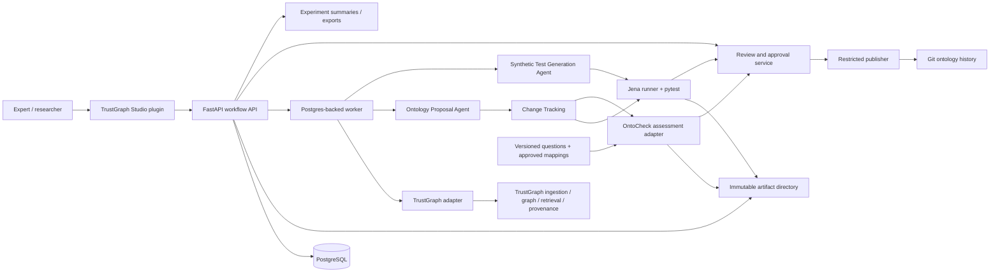

# Deloitte MSc Project: Human-in-the-Loop Ontology Engineering with Agentic AI and Automated Reasoning — Implementation Plan

> **For any development agent or human developer:** Implement one checked task at a time using the incremental instructions in Section 16. Use the tools and workflow available in your environment; no particular AI assistant, agent framework, or skill package is required. Use subagents only when the user explicitly chooses that method. This file authorizes planning, not deployment or access to Deloitte systems.

**Goal:** Build and evaluate a source-grounded Ontology Engineering Studio in which AI proposes ontology changes, executable checks expose modelling problems, and a human expert controls every approved ontology release.

**Architecture:** Extend the TrustGraph Workbench with a React/TypeScript plugin. A custom Python FastAPI application coordinates proposal generation, change tracking, synthetic test generation, Jena validation, OntoCheck assessment, expert review, Git publication, and experiments. TrustGraph supplies ingestion, knowledge extraction, GraphRAG/Ontology RAG, and retrieval provenance; PostgreSQL records workflow state and immutable artifact references.

**Tech stack:** TrustGraph and its UI plugin template; React/TypeScript; Python/FastAPI/Pydantic/SQLAlchemy/Alembic; PostgreSQL; RDF/Turtle, OWL vocabulary, SHACL, SPARQL; Apache Jena Java runner; OntoCheck behind a project-owned adapter; pytest; Git; Docker Compose for a local research deployment. An OWL 2 DL reasoner is optional and requires a separate compatibility decision.

**Spec:** Sections 1–15 of this file are the self-contained specification; Section 16 is the implementation backlog. No separate specification is required to begin the first task.

**Document date and verification date:** 31 October 2026, Europe/Amsterdam. Technical capability statements below were checked against official documentation on that date. No software was installed or exercised while preparing this blueprint. Exact compatible release versions remain a mandatory first-task decision.

**OntoCheck alignment revision:** Aligns this plan with the supplied proposal's four conditions A–D and adds OntoCheck as the query-driven assessment component. Source reviewed at commit `69d42e38979f381fe531ae547fcc49b8ad58ef15` (package metadata `0.1.3`); source review does not establish runtime compatibility or equivalence with the PyPI distribution. See [ONTOCHECK_REVIEW.md](ONTOCHECK_REVIEW.md) for evidence and limitations.

**Context:** Continuation of [Write proposal introduction](chatgpt-conversation://6ae4ceb4-e6b4-83ed-a68d-a5b14bc3baf6). The accessible chat contains partial summaries of the workflow, interface, evaluation, and Modified Delphi discussions. The explicit requirements accompanying this file are authoritative where those summaries are incomplete. Proposed defaults in this plan are implementation choices, not commitments already made by Deloitte.

## Global constraints

- Keep all four candidate domains open until a bounded use case is selected with Deloitte.
- Deliver a minimal vertical slice before expanding the interface or research automation.
- Agents may create candidates, explanations, and tests; they may never overwrite or promote an approved ontology autonomously.
- Approval covers an exact immutable bundle: candidate ontology, shapes, rules, tests, source snapshot, and validation configuration. A changed bundle requires new validation and review.
- Preserve approved ontology commits, source identities, review decisions, and validation artifacts. Corrections create successors.
- Treat retrieved documents and model outputs as untrusted data. Never execute model-generated Python, shell commands, arbitrary Jena rules, or unrestricted SPARQL.
- Distinguish ontology semantics, data constraints, and executable expectations. A passing Jena/SHACL suite is not proof of real-world correctness or complete OWL 2 DL consistency.
- Distinguish OntoCheck task-vocabulary coverage/utilisation and schema fitness from query-answer correctness, inference precision/recall, source fidelity, and approved semantic mappings. No assessment score grants publication authority.
- Use public or synthetic documents until Deloitte approves a data-handling and deployment arrangement.
- Pin dependencies, model identifiers, prompts, inference settings, and experiment inputs before comparing results.
- PostgreSQL is application storage; do not assume it replaces TrustGraph's own graph, vector, messaging, or document storage services.

## Review focus

These five failure classes must have explicit tests in the owning implementation tasks:

1. Concurrent or stale approvals: publishing a proposal based on an old head must fail with a conflict, even if its checks passed earlier (Tasks 3 and 8).
2. Misleading evidence: a missing chunk, changed source, or fabricated quotation must be visible and block submission for review (Tasks 4 and 5).
3. False validation success: timeout, parser failure, unsupported semantics, or a broken runner must never become `passed` (Task 6).
4. Approval bypass: an agent credential, native editor, direct endpoint, or retry must not mutate the approved release or duplicate publication (Tasks 1 and 8).
5. Research leakage: a generated training test or an expert revision must not silently enter the frozen held-out evaluation set (Tasks 7 and 10).

---

## 1. Research purpose and domain selection

### 1.1 Intended contribution

Develop a reproducible prototype and evaluate whether source-grounded agent proposals, automated validation, and expert review improve ontology usefulness and reduce correction effort. Reuse OntoCheck's existing query-driven assessment and benchmark facilities where compatible. The research contribution is the integrated repair/review workflow, traceability, and controlled empirical comparison; ontology-quality metrics and competency benchmarking are existing work, not claimed inventions. It is not a general legal compliance engine.

### 1.2 Four open candidate domains

| Candidate domain | Example of a bounded study task, subject to Deloitte selection | Main scoping concern |
|---|---|---|
| Financial regulatory compliance, including DORA | Model relationships among a small agreed set of ICT services, providers, evidence items, and selected obligations | Select exact provisions and document editions; do not claim coverage of all DORA requirements |
| Financial crime, including AML | Model a synthetic customer-due-diligence evidence workflow and a limited set of review triggers | No real customer records or operational suspicious-activity decisions in the MVP |
| Risk management | Link a limited risk taxonomy, controls, owners, and assessment evidence | Agree what counts as a risk, control, and assessment rather than modelling every risk discipline |
| Data governance | Model ownership, dataset classification, lineage, and a small policy subset | Separate business meaning from technical lineage and access enforcement |

These are examples, not selected scope or regulatory interpretations. Any later interpretation of law must be checked against the exact official texts and reviewed by Deloitte's relevant expert.

### 1.3 Selection workshop and scope contract

Deloitte supervisor, domain expert, and student select **one** domain and **one** bounded task. Score each candidate 1–5 on document availability, expert availability, modelling ambiguity, measurable competency questions, confidentiality burden, and feasibility within the thesis calendar. Document the rationale; a score supports discussion rather than automatically selecting a domain.

Create `docs/domain-scope.md` containing:

- Selected domain, use-case owner, intended users, and one concrete decision/query the ontology supports.
- Included concepts and relationships; explicit exclusions; source authority and precedence rules.
- Proposed pilot size: 5–15 short public/synthetic documents or a comparably small selected corpus, 10–20 competency questions, and a seed vocabulary of roughly 10–30 classes/properties. Adjust before freezing; these are capacity targets, not quality metrics.
- Competency question IDs, plain-language intent, expected evidence, and proposed SPARQL answer specification.
- Expert-reviewed question-to-IRI bindings and reuse mappings; fixed domain namespace/import scope; development versus held-out assessment split. An approximate label match is a suggestion, not an approved equivalence.
- Exact document editions, retrieval dates, effective dates where relevant, and rights/classification.
- Required inference profile and whether any question genuinely requires OWL 2 DL.
- Named reviewer, final approver, review availability, study consent, and escalation owner.
- Frozen pilot acceptance criteria and research protocol version.

**Gate:** Deloitte signs off this scope before domain-specific implementation or collection of confidential material. Engineering may proceed earlier using a small neutral synthetic fixture explicitly labelled `demo`, which must not be reported as Deloitte's selected domain.

## 2. MVP boundary and later scope

### 2.1 MVP deliverable

One local/private research deployment, one selected project/use case, one corpus snapshot, one ontology lineage, one human approval authority, and a complete ingestion → proposal → test → review → publication → evaluation workflow.

MVP includes:

- A single TrustGraph Studio plugin with the six views in Section 9, initially simple tables, forms, and detail panels.
- Traceable document ingestion; retrieval of source chunks and graph context.
- A custom Ontology Proposal Agent producing structured, bounded RDF changes with evidence.
- A custom Change-Tracking component producing immutable candidate revisions and readable diffs.
- A synthetic Test Generation Agent that emits a constrained test specification, never executable code.
- A Java Jena runner orchestrated and asserted through pytest, with RDF parsing, explicit inference mode, SHACL, and SPARQL tests.
- A pinned OntoCheck adapter comparing the base and candidate on versioned development questions, with vocabulary and query-fitness reports, reviewed mappings, and evaluator-only held-out assessment.
- Accept, request changes, reject, inspect evidence, and ask a grounded question. Human modifications create a new revision and rerun validation.
- Git-backed approved ontology snapshots, review/audit records, and a basic experiment table with CSV/JSON export.
- Four conditions A–D from the proposal evaluated on the same frozen tasks: one-shot generation, self-revision, reasoner-guided repair, and the complete expert-reviewed workflow.

### 2.2 Deferred unless the core loop is complete

Multiple domains in one study, multi-tenant SaaS, mobile/desktop native clients, production deployment, elaborate ontology graph editing, automatic ontology alignment, complex distributed agents, arbitrary plugin installation, automated legal decisions, live Deloitte integrations, and automated changes to business systems.

Modified Delphi, a formal OWL 2 DL checker, advanced dashboard charts, and retrieval ablations are extensions. Do not defer the basic experiment records, baseline runners, or human approval safeguards.

### 2.3 Definition of MVP success

A new developer can reproduce a synthetic demonstration, submit a candidate, see a deliberately failing check, produce a corrected revision, obtain a recorded human approval, and publish an immutable successor. Every published change links to evidence, checks, assessments, and its approver. The dashboard can compare the four conditions without manual reconstruction of logs.

## 3. Official capability verification and integration TODOs

The following distinction is essential: **documented upstream capability** does not mean **tested compatibility with the selected deployment**. Project-local APIs later in this file are proposed contracts, not TrustGraph APIs.

### 3.1 TrustGraph findings

| Capability | Official evidence checked | Implementation consequence |
|---|---|---|
| React/TypeScript UI plugins | [Build an App](https://docs.trustgraph.ai/build-an-app/) and [plugin setup](https://docs.trustgraph.ai/build-an-app/plugin-setup.html) describe the official template, IIFE bundles, and registration | Reuse the template; do not invent a plugin SDK |
| Registration in a development portal | The [setup guide](https://docs.trustgraph.ai/build-an-app/plugin-setup.html) places bundles under `packages/portal/public/plugins/` and entries in `packages/portal/public/config/components.json`, using `url` and `globalName` | Valid documented starting point; verify it against the pinned portal commit |
| Release-dependent plugin manifests | Official [2.8](https://trustgraph.ai/news/release-2-8) and [2.9](https://trustgraph.ai/news/release-2-9/) notes describe composable plugins and navigation changes | Do not combine configuration examples from different releases without inspection |
| UI client surface | [Build the plugin](https://docs.trustgraph.ai/build-an-app/build-plugin.html) documents `useSocket()` → `BaseApi`, `socket.flow(flowId)` → `FlowApi`, including `triplesQuery`, `graphRag`, `graphRagStreaming`, and `textCompletion` | Names are documented; exact imports, parameter types, lifecycle, and auth wiring must come from pinned source declarations |
| Shared UI packages | [2.8 release notes](https://trustgraph.ai/news/release-2-8) identify `@trustgraph/client`, `@trustgraph/react-provider`, `@trustgraph/react-state`, and `@trustgraph/trustkit` | Check template peer dependencies and shared globals; avoid duplicate React copies |
| Outdated TypeScript examples | The [TypeScript library guide](https://docs.trustgraph.ai/guides/building/typescript-libraries.html) explicitly warns that its Workbench structure/import examples need updating | Do not copy its older unscoped package examples into the implementation |
| Python gateway client | [Python API guide](https://docs.trustgraph.ai/guides/building/python-api.html) documents `trustgraph-base`, `from trustgraph.api import Api`, `api.flow().id(...)`, `triples_query`, and `graph_rag` | Keep calls inside one adapter; match package version to the deployed backend |
| Document ingestion | [Document processing guide](https://docs.trustgraph.ai/guides/building/document-processing-python.html) documents adding a library document and separately submitting it for processing | Upload success is not ingestion completion; poll/observe processing status |
| Ontology RAG | The [Ontology RAG guide](https://docs.trustgraph.ai/guides/ontology-rag/) describes ontology-guided information extraction | It uses an ontology to guide extraction; it does not replace our ontology proposal or formal validation components |
| Retrieval provenance | [Explainability guide](https://docs.trustgraph.ai/guides/building/explainable-ai.html) describes explain events and source tracing; [extraction provenance CLI](https://docs.trustgraph.ai/reference/cli/tg-show-extraction-provenance.html) describes document/page/chunk/subgraph derivation | Preserve raw provenance alongside normalized evidence; query-time explanations and extraction provenance are separate artifacts |
| Isolation | [Workspace documentation](https://docs.trustgraph.ai/architecture/workspaces.html) describes workspace-scoped identity and storage | Verify credential scope; collections/flows alone are not authorization boundaries |

**Compatibility caution:** Some Python/CLI examples still show port `8088`, while the 2.8 release notes report a changed default of `8888`. Configure URLs from the actual deployment; do not bake either port into client logic. This is a documentation mismatch, not evidence that either example will work unchanged.

### 3.2 Apache Jena findings

- [Jena inference documentation](https://jena.apache.org/documentation/inference/) provides RDFS, OWL/Mini/Micro, and generic rule reasoners. Its built-in OWL coverage is incomplete. Use a named, pinned inference configuration and explicitly limit supported constructs; never label a Jena-only run “complete OWL 2 DL consistency checking.”
- [Jena SHACL documentation](https://jena.apache.org/documentation/shacl/) supports SHACL Core and SPARQL constraints and documents `shacl validate --shapes SHAPES.ttl --data DATA.ttl`. The Java API exposes `Shapes.parse(...)`, `ShaclValidator.get().validate(...)`, and RDF validation reports. Prefer the Java API in our runner for stable machine-readable reporting.
- [Jena ARQ documentation](https://jena.apache.org/documentation/query/) supplies SPARQL queries for competency questions and expected/unwanted inference tests. Our runner must restrict queries and network access; ARQ's wider features are not all safe for generated inputs.
- A separate Fuseki service is unnecessary for the MVP: use an isolated file-based Java process. If Fuseki is added later, its SHACL endpoint requires explicit configuration; the [SHACL documentation](https://jena.apache.org/documentation/shacl/) says it is not enabled by default.

These are documentation checks, not a claim that a particular Jena/Java combination has been tested. Use `jena-core`, `jena-arq`, and `jena-shacl` from the same pinned release and verify the chosen Java runtime against that release.

### 3.3 OntoCheck findings

Reviewed the [repository](https://github.com/cwru-sdle/OntoCheck/tree/69d42e38979f381fe531ae547fcc49b8ad58ef15), [task metric implementation](https://github.com/cwru-sdle/OntoCheck/blob/69d42e38979f381fe531ae547fcc49b8ad58ef15/src/ontocheck/task_based_metric.py), [query-fitness implementation](https://github.com/cwru-sdle/OntoCheck/blob/69d42e38979f381fe531ae547fcc49b8ad58ef15/src/ontocheck/query_fitness.py), and [benchmark runner](https://github.com/cwru-sdle/OntoCheck/blob/69d42e38979f381fe531ae547fcc49b8ad58ef15/src/ontocheck/benchmark/runner.py) on 31 October 2026.

| Observed upstream capability | Integration decision |
|---|---|
| Turtle input, multiple-file merge, SPARQL question files, selected structural/annotation metrics | Feed only immutable candidate/import artifacts and reviewed question exports; do not reimplement the full assessment toolkit |
| Task `recall` / `task_coverage` and `precision` / `ontology_utilization` are vocabulary-overlap ratios | Display **task-vocabulary coverage** and **ontology-vocabulary utilisation**; retain raw upstream keys and denominators, separate from answer/inference precision |
| Basic overlap uses local names and regex extraction of configured prefixes | Freeze explicit namespaces; flag duplicate local names across included namespaces and unsupported query-term syntax; verify full-IRI requirements separately; never use raw overlap as an equivalence oracle |
| Conceptual fitness separates exact/entailed from approximate support; automatic same-prefix mapping defaults to enabled | Call the pinned fitness API with `authorize_prefix_mapping=False` and explicit expert-approved `mappings`; retain strict and approximate scores and ambiguity separately |
| Structural fitness evaluates task schema paths, with configurable weighting, path bound and decay | Freeze the task graph, weights, `max_hops`, and `lam`; a schema path is a diagnostic, not proof that instance answers or entailments are correct |
| Benchmark suites, replaceable reasoner registry, optional HermiT/Owlready integrations | Reuse compatible suites in the independent evaluator; verify inference semantics against Jena fixtures. Built-in profiles are not a verified Jena adapter or a replacement for SHACL |
| Assessment API permits network use by default; some metrics concern remote resources | Use an explicit offline metric allowlist and network-restricted worker; set `allow_network=False` where supported. Do not run `metrics=all` on confidential inputs |
| Metadata version `0.1.3`; repository LICENSE states CC BY 4.0 | Pin the inspected commit and dependency lock; preserve attribution; verify the selected install artifact, requirements, and organisational suitability before use |

These are source-review findings. No OntoCheck dependency install, upstream test run, or Jena/OntoCheck compatibility exercise has been completed in this revision.

### 3.4 Blocking integration TODO register

| ID | Question / owner | Required evidence and exit criterion | Fallback / stop rule |
|---|---|---|---|
| TODO-TG-01 | Backend/UI/template/client versions; integration developer | Record release tags, commits, image digests, package versions, and licenses in `infra/versions.lock.yaml`; build and load template | Use a known compatible release pair; never build against unpinned `latest` |
| TODO-TG-02 | Plugin entry/export, manifest choice, provider imports, shared globals; frontend developer | Compile against actual template and portal; smoke test mount/unmount, theme, authenticated read | Keep one plugin entry with internal tabs; a standalone dev harness is temporary, not a silent product redesign |
| TODO-TG-03 | Ingestion submission/status and errors; backend developer | One document transitions through upload/processing/complete; capture request/response schema and failure fixture | Block real ingestion until verified; use an explicitly labelled fake adapter in tests |
| TODO-TG-04 | GraphRAG context/evidence access and trace persistence; backend developer | Retrieve a graph result, resolve an edge to a chunk, fetch exact chunk content, prove workspace isolation | Do not accept prose-only answers as evidence; block review if evidence cannot be resolved |
| TODO-TG-05 | Ontology RAG configuration/loading and workspace/flow isolation; backend developer | Load seed ontology in sandbox; prove extraction uses it; record snapshot and flow configuration | Core GraphRAG slice can proceed, but Ontology RAG integration remains incomplete and visible |
| TODO-TG-06 | Approved ontology mirror/read-only UI; security owner | Demonstrate native editing cannot bypass the canonical approval boundary; test API credentials and backend roles | Disable native save/import for the approved view or expose only a read-only mirror; keep candidates elsewhere |
| TODO-JENA-01 | Jena release, Java level, inference profile and RDF handling; validation developer | Compile runner; pass SHACL positive/negative, RDFS inference, malformed RDF, language-tag/typed-literal fixtures | Restrict the supported profile; do not downgrade errors to pass |
| TODO-ONTOCHECK-01 | OntoCheck commit/distribution, dependencies, selected metrics and license; assessment developer | Pin reviewed commit or re-review replacement; run offline coverage/fitness fixtures, same-local-name namespace collision, empty vocabulary, mapping authorisation, unsupported query, malformed input and timeout cases; record raw/normalized outputs | Use a clearly labelled fake adapter during construction; the core OntoCheck integration remains incomplete until verified; no silent replacement by home-grown scores |
| TODO-ONTOCHECK-02 | Executable benchmark reuse and inference compatibility; research owner | Match selected benchmark cases, graph scope and inference profiles against known-answer Jena fixtures; verify held-out isolation | Keep Jena as workflow validation authority and report incompatible OntoCheck benchmark measures as unavailable; do not silently compare different semantics |
| TODO-DL-01 | Optional OWL 2 DL checker; research owner | Select and verify official reasoner/OWLAPI compatibility, license, profile checking, timeout, satisfiability and consistency fixtures | Defer; report DL checks as `not_run`, and reject unsupported DL-dependent proposals from MVP publication |
| TODO-ORG-01 | Deloitte scope/data/model hosting/expert access; student and supervisor | Signed scope and permitted data/model environment | Public/synthetic demo only |

Store small sanitized compatibility fixtures in `tests/contracts/fixtures/` and source links with access dates in `docs/integrations.md`. Do not store credentials or confidential traces. A TODO closes only after its smoke test and evidence are recorded.

## 4. System boundaries and module contracts

### 4.1 Architecture



Use one FastAPI application and one worker process. A PostgreSQL jobs table with leases is sufficient; do not add a second queue system merely for custom application jobs. TrustGraph's own deployment may have its own messaging infrastructure.

### 4.2 Responsibilities

| Module | Input → output | Owns / must not do |
|---|---|---|
| TrustGraph adapter | Ingest/retrieve/trace requests → normalized source records and context bundles | Upstream compatibility only; no approval or canonical ontology writes |
| Proposal Agent | Requirements, base ontology, evidence, feedback → structured proposal draft | Proposes classes, properties, supported axioms and rationale; cannot approve or execute tools freely |
| Change Tracking | Base + explicit additions/deletions → candidate, RDF diff, affected-term list | Deterministic materialization and revision lineage; never edits an approved file in place |
| Test Generation Agent | Requirements + candidate + evidence → synthetic fixture/test specs | Labels assumptions and oracle sources; cannot change the frozen benchmark or weaken required checks |
| Validation service | Immutable bundle → parse/profile/inference/SHACL/test report | Executes Jena and controlled pytest harness; cannot auto-repair or auto-approve |
| OntoCheck assessment adapter | Exact base/candidate + frozen questions/imports/mappings/config → versioned coverage, fitness and diagnostic reports | Preserves upstream evidence and statuses; no automatic acceptance of approximate matches; no approved writes or access to held-out data during development |
| Review service | Validated revision + human decision → immutable review records | Enforces role, exact bundle, and policy; changes invalidate prior eligibility |
| Publisher | Approved exact bundle + expected head → new approved version | Sole writer of approved Git ref and application head; no reasoning or generation |
| Experiment service | Frozen tasks + condition configs + run records → metrics/exports | Never mixes evaluation oracles into agent context |

### 4.3 Project-owned Python interfaces

Define typed request/response models in `contracts.py` modules; these signatures are our stable interfaces. All IDs are UUIDs except external IRIs, Git hashes, and SHA-256 digests.

```python
class TrustGraphGateway(Protocol):
    async def ingest(self, request: IngestRequest) -> IngestReceipt: ...
    async def ingestion_status(self, receipt: IngestReceipt) -> IngestStatus: ...
    async def retrieve(self, request: RetrievalRequest) -> ContextBundle: ...
    async def resolve_evidence(self, ref: EvidenceRef) -> EvidenceRecord: ...

class ProposalGenerator(Protocol):
    async def propose(self, request: ProposalRequest) -> ProposalDraft: ...

class ChangeTracker(Protocol):
    def materialize(self, base: OntologySnapshot,
                    draft: ProposalDraft) -> CandidateBundle: ...
    def diff(self, base: OntologySnapshot,
             candidate: OntologySnapshot) -> OntologyDiff: ...

class SyntheticTestGenerator(Protocol):
    async def generate(self, request: TestGenerationRequest) -> TestSuiteDraft: ...

class Validator(Protocol):
    async def validate(self, bundle: ValidationBundle) -> ValidationReport: ...

class OntologyAssessor(Protocol):
    async def assess(self, bundle: AssessmentBundle) -> AssessmentReport: ...

class ReviewService(Protocol):
    async def decide(self, actor: Actor, request: ReviewRequest) -> ReviewDecision: ...

class Publisher(Protocol):
    async def publish(self, actor: Actor, request: PublishRequest) -> Publication: ...
```

`Protocol` and models are project code, not imports claimed to exist upstream. Implement a fake gateway first, then a real gateway behind the same contract. A retrieval result must include source-bearing records, not only generated answer text.

Define the referenced boundary types with the following minimum fields; Section 5 supplies their persistence and integrity rules:

| Type | Required contract fields |
|---|---|
| `Actor` | Trusted identity subject, actor kind (`human`/`service`), project membership and roles resolved by the server |
| `ArtifactRef` | Artifact UUID, SHA-256, media type, byte length, schema version; storage key remains server-only |
| `IngestRequest` | Project/source IDs, verified document artifact, source URI/metadata, server-resolved workspace/flow/collection binding, seed/config digests, idempotency key |
| `IngestReceipt` | Local ingestion UUID, upstream document URI and processing identifier if provided, binding/config digest |
| `IngestStatus` | `uploaded`/`processing`/`completed`/`failed`, sanitized error, provenance artifact references, last observed time |
| `RetrievalRequest` | Project/corpus IDs, query, base ontology digest, server-resolved binding, entity/triple/chunk/token limits, retrieval config digest |
| `ContextBundle` | Immutable manifest/digest, retrieval request, graph context artifact, evidence IDs and records, raw trace artifact references, truncation and unresolved-source flags |
| `EvidenceRef` | Project/corpus/document IDs, upstream chunk URI and optional page/graph URI, expected source/chunk hashes |
| `EvidenceRecord` | Resolved reference, authorized locator, immutable chunk artifact, verified quotation/span, resolution status; see Section 5 |
| `ProposalRequest` | Project/base/corpus IDs, competency-question specs, context bundle, admitted profile, optional prior revision and feedback, generation budget/config |
| `ProposalDraft` | Structured changes, base ID, summary, competency-question IDs, assumptions and unresolved questions; see Section 5.3 |
| `OntologySnapshot` | Version or candidate ID, ontology artifact/digest, namespace/profile, parent version ID |
| `CandidateBundle` | Candidate snapshot, diff artifact, context/evidence references, shapes/rules/test references, corpus/profile/config references and frozen bundle digest |
| `TestGenerationRequest` | Candidate bundle, development competency questions, permitted fixture vocabulary, supplied evidence, generation limits; never held-out oracles |
| `TestSuiteDraft` | Development `TestCaseSpec` list, fixture artifacts, generation record, assumptions and oracle-review requirements |
| `ValidationBundle` | Frozen candidate manifest/digest, exact test suites and graph/inference settings, runner/environment digest and resource limits |
| `ValidationReport` | Bundle digest, validation run ID, stage/case outcomes and raw report artifacts; see Section 8.5 |
| `AssessmentBundle` | Base/candidate hashes, question set and split, approved mapping/import/namespace artifacts, selected metrics/settings, OntoCheck commit and environment digest, limits; immutable manifest/digest |
| `AssessmentReport` | Assessment run/bundle IDs, ontology/question/config hashes, raw outputs, normalized metrics with numerators/denominators and status, per-question unsupported concepts/paths, mapping tiers, base-to-candidate deltas and limitations; see Section 8.6 |
| `ReviewRequest`, `PublishRequest` | Exact payloads and concurrency requirements in Section 7.2; actors are never caller-supplied |
| `ReviewDecision`, `Publication` | Immutable IDs, exact revision/bundle linkage, actor and decision/approval references, status and resulting version/commit if completed |

Use UUIDs for local object references and explicit string enums for statuses. Treat hashes and version fields as mandatory, not optional annotations. Mutable processing status is recorded as append-only observations with a current projection; it must not alter frozen manifests.

## 5. Data and artifact models

### 5.1 Conventions

- UUID identifiers; timestamps stored in UTC and displayed in the user's timezone.
- Every record belongs to `project_id`; composite foreign keys/checks prevent cross-project links.
- Immutable artifacts have `sha256`, byte length, MIME type, server-generated relative storage key, and schema version. Never accept filesystem paths from clients.
- Hash canonical JSON manifests with sorted keys and fixed encoding. Hash RDF using the normalization rules below; hash original document bytes separately.
- Separate stable concept IRIs from version identifiers. Choose a project namespace with Deloitte; use `https://example.org/oe-demo/` only for examples.
- Pydantic rejects unknown fields and applies explicit size limits. Generate the frontend types from our OpenAPI schema.

### 5.2 Relational schema

| Entity/table | Required fields beyond common IDs/timestamps | Invariants |
|---|---|---|
| `projects` | name, domain enum, scope_artifact_id, workspace_binding_id, approved_version_id, pending_publication_id, review_policy_id | Domain may be `unselected`; publication disabled until scope accepted |
| `project_members` | user_subject, role (`researcher`, `reviewer`, `approver`, `viewer`) | Identity from trusted auth, not request JSON |
| `review_policies` | policy artifact/digest, required checks, designated approvers, mode and effective version | Immutable; projects select a version explicitly; policy changes require renewed publication eligibility |
| `workspace_bindings` | workspace identifier, flow IDs, collection IDs, credential secret reference, config digest | No secret value stored in this table; binding chosen server-side |
| `source_documents` | external URI, bytes artifact, title, edition, source URL, classification, rights, effective_date nullable, retrieval_time, supersedes_id nullable | A changed document creates a new row/URI; no replacement of original bytes |
| `ingestion_runs` | source_id, adapter receipt, flow/config/seed digests, status, error, provenance artifact | `completed` only after status and source retrieval check |
| `corpus_snapshots` | ordered source/ingestion IDs, manifest artifact, digest | Immutable input selection; mixing editions must be explicit |
| `evidence_records` | corpus_id, document_id, upstream chunk/page/graph IRIs, locator, chunk artifact/hash, span_start/end nullable, quote, quote hash, resolution status | Span offsets are Unicode code points in normalized chunk text; document byte hash remains separate |
| `competency_questions` | code, text, rationale, required flag, oracle reference, query spec artifact, protocol version | Frozen evaluation variants cannot be revised in place |
| `ontology_versions` | parent_version_id nullable, ontology artifact, shapes/rules/test suite artifacts, manifest digest, Git commit, status | Approved version is immutable; seed import also requires explicit human acceptance |
| `proposals` | base_version_id, created_by, origin (`agent`/`human`), supersedes_proposal_id nullable | Stable change request identity; no write access to approved ref |
| `proposal_revisions` | proposal_id, revision number, candidate/diff artifacts, bundle_digest, corpus_id, context artifact, generation_run_id nullable | Unique `(proposal_id, revision)`; content immutable |
| `change_items` | revision_id, operation, triple, affected IRI, evidence IDs, rationale, impact labels | Every substantive change requires evidence or explicit expert-authored justification |
| `test_suites` | origin (`manual`, `synthetic`, `benchmark`), split (`development`, `held_out`), specs/fixtures artifacts, oracle_review_id nullable, digest | Synthetic tests are not automatically trusted benchmark oracles |
| `validation_runs` | revision_id, bundle_digest, engine/config/environment digests, per-stage outcomes, report artifacts, start/end | Timeout/error/unsupported are distinct outcomes; append a new run on retry |
| `assessment_runs` | revision_id, approval_bundle_digest, assessment_bundle_digest, base/candidate/question/mapping/import/config/environment hashes, split, OntoCheck commit, metric statuses and report artifacts | Append-only; base and candidate use identical workload/config; held-out reports are evaluator-only until outputs are frozen |
| `reviews` | revision_id, bundle_digest, validation_run_id, required_assessment_run_ids, actor, decision, rationale, review_policy_id, round_id nullable | Append-only decisions; human identity required; all referenced reports match the exact bundle and policy |
| `review_sessions` | reviewer, revision_id, start/pause/resume/end events, active seconds, round_id nullable | Track active time separately from waiting for jobs |
| `publications` | revision_id, approval IDs, expected_head, new_version_id, state, idempotency_key, error | One publication per revision; one pending publication per project |
| `jobs` | kind, payload digest/reference, status, attempt, lease_until, heartbeat, idempotency_key | Durable lease/retry; never retry publication blindly |
| `generation_runs` | task/condition, model/provider ID, prompt artifact/hash, settings, seed nullable, token/cost/latency usage, output artifact | Store observed usage; missing provider seed support is recorded |
| `experiment_runs` | protocol_id, condition, task_id, replicate, corpus/base digests, generation/validation/review IDs, code/environment digests | Unique logical run key; failures remain in exports |
| `metric_observations` | experiment_run_id, metric_name, value nullable, denominator, unit, missing_reason | Never encode unavailable metrics as zero |
| `audit_events` | sequence, actor/type, action, entity, correlation ID, payload digest, previous_event_hash, event_hash | Append-only service role; hash chain aids detection but is not tamper-proof against a database administrator |

Optional later: `delphi_rounds`, `delphi_ratings`, `delphi_summaries` with revision/policy linkage. Use migrations for all changes.

### 5.3 RDF changes and proposal payload

For the MVP, support explicit named triples with IRI subjects, IRI predicates, and IRI or typed/language-tagged literal objects. Preserve datatype and language exactly. Forbid deletion of nonexistent triples, duplicate additions, conflicting add/delete of the same triple, and namespace changes without review.

```json
{
  "base_version_id": "11111111-1111-4111-8111-111111111111",
  "summary": "Represent service ownership",
  "changes": [
    {
      "operation": "add",
      "triple": {
        "s": {"kind": "iri", "value": "https://example.org/oe-demo/hasOwner"},
        "p": {"kind": "iri", "value": "http://www.w3.org/1999/02/22-rdf-syntax-ns#type"},
        "o": {"kind": "iri", "value": "http://www.w3.org/2002/07/owl#ObjectProperty"}
      },
      "evidence_ids": ["22222222-2222-4222-8222-222222222222"],
      "rationale": "The selected source describes an accountable owner.",
      "risk": "changes_query_vocabulary"
    }
  ],
  "competency_question_ids": ["CQ-01"],
  "assumptions": ["Owner identity is supplied by synthetic fixtures."],
  "unresolved_questions": []
}
```

This is a neutral synthetic example, not a Deloitte modelling decision. Validate namespace allowlists and bounds before materialization. Suggested initial limits: 100 triple operations, 20 evidence records per request, and 1 MiB proposal JSON; configure and record changes.

**Logical axioms:** MVP supports a documented restricted vocabulary: class/property declarations, subclass/subproperty relationships, domain/range, labels/comments, and explicitly supported disjointness/inverse/transitivity constructs only when the chosen engine/profile and tests cover them. Domain/range axioms infer types; they do not act as required-field constraints. Required data belongs in SHACL. Declare the exact admitted predicates in `config/modelling-profile.yaml`; unsupported constructs block publication rather than being silently ignored.

OWL restrictions and RDF lists usually require blank nodes. Defer complex expressions initially. If imported ontologies contain blank nodes, use a verified RDF canonicalization/skolemization strategy with reversible export, or accept them as a frozen seed and block unsupported edits. Do not claim that sorting Turtle lines or renaming blank nodes is a semantic diff.

### 5.4 Snapshot, diff, and approval bundle

`OntologyDiff` contains added/deleted normalized triples, affected IRIs, renamed/deprecated concepts where explicitly declared, impacted competency questions, evidence changes, and syntactic versus inferred effects. RDF graph equality for the admitted profile is the minimum; semantic equivalence detection is out of scope.

For named-triple MVP graphs, serialize deterministic sorted N-Triples for hashing and human-friendly Turtle for display. Exact literal lexical forms remain significant. Do not mix TrustGraph RDF-star provenance into the core ontology parser: retain raw provenance and normalize references separately until runner support is verified.

`bundle_digest` covers a manifest referencing hashes of candidate ontology, shapes, rules, required and generated test suites, corpus snapshot, evidence/context bundle, inference/profile settings, validation environment, and development assessment inputs (question export, reviewed mappings, imports, namespace scope, metric configuration and OntoCheck environment). It contains no held-out inputs. Validation and development assessment runs reference that same approval-bundle digest; each assessment also hashes its own input manifest. Output reports do not enter their own input digest. An approval records the validation run and required development assessment run IDs. A changed mapping/configuration is a successor bundle requiring reruns and fresh review. Historical decisions remain intact.

### 5.5 Synthetic test specification

A `TestCaseSpec` has:

- `test_id`, competency question/change IDs, `origin`, `split`, and `oracle_status`.
- Synthetic fixture artifact ID/hash and the ontology/base it targets.
- Kind: `ask`, `select_rows`, `shacl`, or optional `dl_consistency`.
- For ASK: parsed query plus expected boolean. For SELECT: expected canonical typed bindings and comparison mode (`exact` or `contains`).
- For SHACL: expected conformance and normalized expected violation signatures `(focusNode, path, sourceShape, severity)`; ignore unstable human message text.
- Rationale, source evidence IDs, assumptions, and human oracle reviewer if applicable.
- Expected inference mode and timeout.

A deliberately invalid fixture that produces the expected SHACL violation is a **passing test**. Do not require every synthetic fixture to conform. A negative ASK result means the assertion was not entailed under the selected engine; it is not logical proof of its negation under the open-world assumption.

## 6. Workflow and state transitions

### 6.1 End-to-end sequence

```mermaid
sequenceDiagram
    actor R as Researcher
    actor E as Expert
    participant S as Studio / FastAPI
    participant T as TrustGraph
    participant A as Proposal + Test Agents
    participant V as Change Tracking / Jena
    participant O as OntoCheck adapter
    participant P as Publisher / Git
    R->>S: Select scope, corpus and accepted seed
    S->>T: Upload and submit source documents
    T-->>S: Processing status and resolvable provenance
    R->>S: Request proposal against explicit base version
    S->>T: Retrieve relevant graph, ontology and source context
    T-->>S: Evidence-bearing context bundle
    S->>A: Generate bounded change draft
    A-->>S: Structured changes, rationale, evidence IDs
    S->>V: Materialize immutable candidate and diff
    S->>A: Generate synthetic test specs
    A-->>S: Fixtures and proposed expectations
    S->>V: Run fixed + generated tests on exact bundle
    V-->>S: Reports, limitations and failures
    S->>O: Assess base/candidate with frozen development workload
    O-->>S: Coverage, fitness, mapping tiers and per-question diagnostics
    alt Failed, unsupported or unresolved evidence
        S-->>R: Block submission; show problems
        R->>S: Request revision using failure feedback
    else Eligible for review
        S-->>E: Present exact revision, diff, evidence, tests and assessments
        E->>S: Ask questions / accept / request changes / reject
        opt Changes requested
            S->>A: Create successor revision with explicit feedback
            S->>V: Revalidate and require new review
        end
        E->>S: Approve exact validated bundle
        E->>S: Publish with expected approved head
        S->>P: Verify roles, approval, digest and head; append release
        P-->>S: Immutable Git commit and version manifest
    end
    R->>S: Run frozen baseline/full-system evaluation and export
```

### 6.2 State machines

Maintain immutable revisions and derive their current status from controlled transitions/events:

`draft → validating → validation_failed | validated → in_review → approved | changes_requested | rejected`

`approved → publication_pending → published | publication_failed`

- `draft → validating`: server freezes the bundle. Agent/test generation must have finished first.
- `validated → in_review`: required checks pass; evidence resolves; unsupported constructs absent; trusted test policy satisfied.
- Required development assessments must complete under the frozen policy before review. A completed low diagnostic score prompts review; it is not automatically a failed logical check. Error/timeout/unsupported is visible and blocks eligibility when the affected assessment is required. No global utilisation threshold is assumed.
- `in_review → approved`: an authorized human explicitly accepts the exact revision and validation run. Approval never means publication happened.
- `changes_requested`: create a successor draft; do not edit reviewed content. Same rule applies to direct expert edits.
- A new current ontology head makes an unpromoted proposal `stale` for publication. Preserve review history; rebasing creates a new revision, new diff, fresh validation, and fresh approval.
- A validator outage yields `error`, not domain rejection. Failures and errors remain distinct in the UI and metrics.
- Permit at most two agent repair attempts by default. On exhaustion, pause for human action; retain every attempt.
- Reject/review is change-set-wide in the MVP. Per-triple approval is deferred because dependencies between axioms make partial promotion unsafe.

### 6.3 Publication and recovery algorithm

1. Authenticate the human actor and authorize `approver`; agents cannot call publication with an approver identity.
2. Resolve the idempotency key. Return an existing completed result, or the same pending operation; reject a reused key with different input.
3. Verify the exact approval, bundle digest, validation result, required development assessment run IDs/completion, current review policy, source eligibility, and expected head. No required stage may be `failed`, `error`, `timeout`, `unsupported`, or `not_run`. A completed diagnostic score is interpreted only through the frozen assessment policy.
4. Under a project row lock, ensure no publication is pending and the base equals the current approved head; reserve a publication ID. Candidate artifacts are already immutable.
5. Create/reuse an immutable Git commit containing the candidate and manifest, with the expected approved commit as parent. Update the dedicated approved ref with Git compare-and-swap (`update-ref` old/new semantics) under the sole publisher's lock. This appends history; never force-rewrite an approved commit.
6. Finalize `ontology_versions`, project head, and publication record in a database transaction, then clear the reservation and emit an audit event/outbox item.
7. A worker can subsequently mirror the approved version to TrustGraph. Mirror failure does not invalidate Git approval; the UI displays the mirror's version and lag. Never present an old mirror as the current approved version.

PostgreSQL and Git do not share a transaction. On a crash, reconciliation checks the reserved publication, immutable manifest, and actual Git ref before finishing the database step. Block another publication until reconciled. If the ref is unexpected, require operator resolution; never force it back automatically. Test crashes before and after each external write. Do not expose a partially finalized version as current. Reverting a published change is a new reviewed proposal and successor commit.

## 7. FastAPI HTTP contracts

All routes below are **project-owned `/api/v1` routes**, not upstream TrustGraph endpoints. Publish an OpenAPI schema; generate TypeScript models/client from it. Scope every query through the authenticated project membership. Paginate list responses with opaque cursors, default 50 and maximum 200.

### 7.1 Endpoint inventory

| Method and path | Request / response | Role and behavior |
|---|---|---|
| `POST /projects` | `{name, domain?}` → `201 Project` | Researcher; `unselected` allowed |
| `GET /projects/{p}` | → `Project`, including current approved version | Member |
| `POST /projects/{p}/scope` | Scope artifact + scope acceptance metadata → scope revision | Researcher uploads; approver explicitly accepts through a scope decision |
| `POST /projects/{p}/scope-decisions` | `{scope_digest, decision, rationale}` → decision | Approver; acceptance enables publication |
| `POST /projects/{p}/documents` | Multipart bytes + title/edition/rights/classification → `201 SourceDocument` | Researcher; public/synthetic MVP, maximum 20 MiB/file |
| `POST /projects/{p}/ingestions` | `{document_id, configured_flow_key}` → `202 JobRef` | Researcher; upstream identifiers resolved server-side |
| `POST /projects/{p}/corpus-snapshots` | `{ingestion_run_ids}` → immutable snapshot | Researcher; only complete, verified ingestions |
| `POST /projects/{p}/seed-imports` | Ontology artifact + profile → `202 JobRef` | Researcher stages initial seed; validated and human-accepted via normal proposal/review flow before first publication |
| `GET /projects/{p}/versions` | → version summaries | Member |
| `GET /projects/{p}/versions/{v}` | → manifest and artifact links | Member |
| `POST /projects/{p}/proposal-jobs` | `{base_version_id, corpus_snapshot_id, competency_question_ids, instruction?}` → `202 JobRef` | Researcher; generation only |
| `GET /projects/{p}/proposals` | → proposal summaries/status | Member |
| `GET /projects/{p}/proposals/{id}/revisions/{r}` | → candidate, diff, evidence, checks, history | Member |
| `POST /projects/{p}/proposals/{id}/revisions` | `{parent_revision, structured_changes, rationale}` → `201 Revision` | Researcher/reviewer; immutable successor; optimistic concurrency |
| `POST /projects/{p}/test-generation-jobs` | `{proposal_id, revision}` → `202 JobRef` | Researcher; generated tests remain development split |
| `POST /projects/{p}/test-oracle-decisions` | `{test_suite_digest, decision, rationale}` → decision | Reviewer; cannot reclassify development tests as frozen benchmark |
| `POST /projects/{p}/validation-jobs` | `{proposal_id, revision, bundle_digest}` → `202 JobRef` | Researcher/reviewer; selects server-approved profile |
| `POST /projects/{p}/assessment-jobs` | `{proposal_id, revision, bundle_digest}` → `202 JobRef` | Researcher/reviewer; development workload and metrics resolved server-side; no caller-supplied paths, mappings or held-out split |
| `GET /projects/{p}/assessments/{id}` | → authorized report, per-question diagnostics and base/candidate deltas | Member for development reports; evaluator-only access for held-out runs |
| `POST /projects/{p}/review-submissions` | `{proposal_id, revision, validation_run_id, required_assessment_run_ids}` → review eligibility record | Researcher; enforces all gates and exact report/bundle linkage |
| `POST /projects/{p}/reviews` | `ReviewRequest` below → `201 ReviewDecision` | Reviewer/approver; only approver can give publication-authorizing acceptance |
| `POST /projects/{p}/question-jobs` | `{proposal_id, revision, question}` → `202 JobRef` | Member; grounded answers and evidence IDs; no mutation |
| `POST /projects/{p}/publications` | `PublishRequest` below → `202 PublicationRef` | Human approver; checks expected head and durable idempotency |
| `GET /projects/{p}/publications/{id}` | → pending/completed/failed publication | Member |
| `GET /projects/{p}/evidence/{id}` | → authorized locator, quote, source hashes, resolution | Member; original content access respects classification |
| `GET /projects/{p}/artifacts/{id}` | → content/download | Member; server maps ID to safe storage key |
| `POST /projects/{p}/review-sessions` | `{revision_id, event}` with event `start`, `pause`, `resume` or `end` → timing record | Human reviewer; reject impossible event order |
| `POST /projects/{p}/experiment-jobs` | `{protocol_id, condition, task_ids, replicate_ids}` → `202 JobRef` | Researcher; frozen protocol only |
| `GET /projects/{p}/experiments` | → run summaries and metrics | Member |
| `GET /projects/{p}/experiments/export?format=csv` (or `format=json`) | → versioned results export | Member; excludes confidential content by default |
| `GET /jobs/{id}` | → status/progress/result reference/error | Authorized project member; no cross-project reads |
| `GET /health/live`, `GET /health/ready` | → process/dependency status | Redacted health only |

For first publication, `base_version_id`/`expected_head` may be null only in the explicit seed-import workflow, under a locked project with no approved version. All later operations require a concrete base. No writable “latest ontology” endpoint exists.

### 7.2 Decision and publication models

```json
{
  "proposal_id": "33333333-3333-4333-8333-333333333333",
  "revision": 2,
  "bundle_digest": "sha256:<64 hexadecimal characters>",
  "validation_run_id": "44444444-4444-4444-8444-444444444444",
  "required_assessment_run_ids": ["66666666-6666-4666-8666-666666666666"],
  "decision": "accept",
  "rationale": "Evidence and required checks support the proposed change.",
  "review_policy_id": "55555555-5555-4555-8555-555555555555"
}
```

`ReviewRequest.decision` is `accept | request_changes | reject`. The server supplies actor/time. In single-expert MVP mode, one designated human approver may review and approve. Record that limitation; do not imply independent dual control.

`PublishRequest` is `{proposal_id, revision, bundle_digest, approval_ids, expected_head}`. Require an `Idempotency-Key` header on publication and asynchronous creation endpoints. Successful job submission returns `{job_id, status_url, correlation_id}`. A repeated identical key returns the existing job; different content returns `409`.

### 7.3 Errors and concurrency

Use a common body `{code, message, details, correlation_id}`. Return `401` unauthenticated, `403` unauthorized, `404` for inaccessible/missing resources, `409` stale revision/head or conflicting idempotency key, `413` size limit, `422` invalid structured content/profile, and `503` unavailable dependency. Do not reveal secrets or another project's identifiers in error details.

Use `If-Match` with the current proposal revision token for revision creation and review submission. Publication also checks the approved head inside the locked operation. Long jobs have `queued | running | succeeded | failed | cancelled` and stage-specific validation outcomes; HTTP `202` never implies checks passed.

## 8. Agents and formal validation

### 8.1 Proposal Agent

Prompt inputs: frozen competency questions, admitted modelling profile, accepted seed/base ontology, retrieved evidence bundle, relevant graph context, previous failed checks, explicit expert feedback, and remaining operation/token budget.

Prompt output: strict `ProposalDraft` JSON as in Section 5, with provenance IDs selected only from supplied evidence, rationale, assumptions, and unresolved questions. Treat self-reported confidence as uncalibrated metadata, never as approval evidence.

Pipeline:

1. Resolve retrieval using a pinned corpus/collection and base ontology digest.
2. Store the context, query/config, graph references, and retrieved chunk hashes.
3. Invoke the model with schema-constrained output where supported; otherwise parse and validate with Pydantic.
4. Check evidence IDs, quotations/spans, namespace/profile, operation limits, deletions, and dependency effects.
5. Materialize candidate and diff deterministically. Unsupported constructs or insufficient evidence produce a blocked draft with explicit questions.

Repair uses only the feedback permitted by the experimental condition and creates a new revision. In the main study B receives no automated reports; C and D share entailment-test diagnostics only during automated repair. OntoCheck development feedback can support D's expert stage. Feeding it to the automated agent requires a separately labelled extension or ablation. No self-directed changes to the test policy, approved ontology, or research protocol.

### 8.2 TrustGraph bootstrapping and Ontology RAG

Avoid circular dependence on an ontology that has not yet been created. Begin with a small human-accepted seed and general ingestion/GraphRAG. The custom Proposal Agent develops the ontology from evidence and requirements. Once a version is approved, an explicitly configured sandbox can use that version for ontology-guided extraction.

Every extraction run records the exact ontology version and flow config. Re-extraction after ontology changes produces a new ingestion/corpus snapshot; do not silently replace the evidence behind existing proposals or experiments. For research comparisons, hold extraction/corpus constant unless retrieval strategy itself is the experimental factor.

### 8.3 Synthetic Test Generation Agent

Generate positive, negative, boundary, contradictory, missing-data, and regression scenarios tied to competency questions and change items. Include types, language-tagged literals, and absent relationships when relevant. Distinguish explicit contradictions from merely unknown facts.

Output fixtures plus `TestCaseSpec` records. A fixed trusted harness translates them into Jena operations and pytest assertions. Human-review test oracles that introduce new domain expectations before they become release-blocking requirements. Keep manually authored sentinel tests mandatory so the agent cannot “repair” an ontology by weakening its own tests.

### 8.4 Jena runner contract

Build `services/jena-runner` as a small Maven project. Python starts it using an argument list, `shell=False`, a fresh run directory, resource limits, and a fixed executable. Proposed invocation, owned by this project:

```text
java -jar oe-jena-runner.jar --manifest <server-generated-run-manifest.json>
```

This command is **not an upstream Jena CLI**. The runner reads only manifest-listed artifact files beneath its run directory. It outputs `report.json`, `shacl-report.ttl`, `query-results.json`, and an optional `deductions.nt`. Define exit codes: `0` completed and checks matched expectations; `2` completed with failed expectations; `3` input/profile error; `4` engine/internal error. Process termination or missing report is `error`/`timeout`, never success. Pytest verifies structured outcomes rather than treating stdout as the truth.

Manifest fields: `schema_version`, `bundle_digest`, paths and hashes for ontology/shapes/rules/fixtures/test specs, `inference_mode`, validation graph mode, time/memory limits, and expected runner version.

### 8.5 Validation stages and semantics

1. **Integrity and syntax:** verify artifact hashes; parse RDF and shapes; validate test/query schemas.
2. **Admitted profile:** reject constructs outside `modelling-profile.yaml`; block external imports unless vendored, hashed, and allowlisted.
3. **Materialization:** default MVP `rdfs` inference; add a separately named `jena_owl_micro` or vetted fixed rule profile only if required and tested. No unrestricted agent-authored rule code.
4. **Data constraints:** run SHACL on the explicitly selected graph (`asserted` or `asserted_plus_inferred`). Default pilot uses asserted-plus-RDFS closure; record that choice in every report. Run metadata constraints on the ontology separately if configured.
5. **Executable expectations:** ASK/SELECT competency questions, wanted inferences, unwanted inference checks, and expected SHACL violations. No SPARQL UPDATE, federated `SERVICE`, filesystem access, extension functions, or remote graph loads. Parse and inspect query algebra; do not rely on string matching alone.
6. **Regression:** run required fixed tests and accepted development tests against the candidate. Preserve failures against the prior version as diagnostic context.
7. **Optional DL:** check OWL 2 profile membership and run a verified complete DL reasoner for consistency and unsatisfiable named classes. If absent, emit `not_run`; publication is allowed only when the selected MVP profile does not require that check.

`ValidationReport` includes engine/version/config, asserted/inferred graph hashes, counts, per-case results, limitations, elapsed time, truncation/resource errors, raw artifact references, and an overall gate outcome. Jena's validity checks supplement the suite; they do not substitute for the selected profile's formal guarantees. UI language should say “required checks passed under profile X,” not “ontology proven correct.”

### 8.6 OntoCheck assessment contract and vocabulary alignment

Implement `OntologyAssessor` behind `integrations/ontocheck/`, with schema translation in `assessments/`. Prefer a separate, pinned Python environment/worker process to isolate dependencies, output files and resource limits. The worker reads only manifest-listed local artifacts and writes reports in its run directory. Configure `allow_network=False` where exposed and enforce network denial outside the library. Selected offline metrics must not trigger endpoint/link checking or runtime language-resource downloads. Vendor permitted resources during environment preparation.

1. Validate the candidate, exact imported ontology snapshots, approved question export and namespace scope. Export reviewed SPARQL with stable `qid`, `question` and `sparql_query` fields; use reviewed `graph_query` task graphs where needed by query fitness. Reject missing/skipped required questions and unsupported workload syntax rather than silently shrinking the denominator.
2. Freeze each requirement's full IRI and approved correspondence in a versioned mapping artifact, with reviewer, rationale, relation type and evidence. Tool-level matching configuration does not itself assert `owl:equivalentClass` or `owl:equivalentProperty`; adding those axioms is a separate reviewed ontology change. Approximate matches and ambiguity stay visible as suggestions.
3. For basic overlap, explicitly set the permitted query prefixes and ontology namespace fragments; record the extracted local-name sets and counts. Collision-check full IRIs before interpreting local-name scores. For conceptual/structural fitness, pass explicit approved `mappings` and `authorize_prefix_mapping=False`; record weighting, path bounds and decay. Do not assume namespace-filter arguments constrain fitness: the inspected API accepts but does not use those arguments, so control the exact input graphs and mappings.
4. Assess base and candidate using identical question/import/config snapshots. Keep strict conceptual support, support including approximate matches, ambiguity, structural fitness, path coverage/stretch, and per-question missing requirements separate. Selected structural/annotation metrics are descriptive and domain-appropriate; no assumed obligation to adopt BFO/CCO or a particular naming style.
5. Preserve raw tool values, keys, source version and statuses. Normalize empty denominators and unavailable scores to `null` with a reason even if upstream overlap returns `0.0`; do not convert a skipped/failed metric into a valid zero or pass. Record upstream parsing/term-extraction limitations and no-question/no-edge cases explicitly.
6. Required development reports become review artifacts tied to the approval bundle. Publication verifies their IDs, hashes and policy just as for required validation. Optional reports may be `not_run` with a reason. Only pre-agreed, justified domain criteria can make a diagnostic score release-blocking; no universal precision/utilisation or aggregate-quality threshold.
7. Held-out assessment uses a separate evaluator identity, job and artifact mount after output freeze. Nothing derived from held-out questions, expected answers, mappings, fitness deficits or counterfactual importance enters agent feedback or engineering review. Use OntoCheck executable benchmark support only after TODO-ONTOCHECK-02; it does not silently replace the Jena semantics. Counterfactual importance and context-weighted framework scores are optional analyses, not new primary outcomes.

An assessment timeout/error cannot be presented as success. Changes to the question set, mappings, imports, metric configuration or engine create a new assessment/bundle identity and require a fresh comparison. API and UI use **vocabulary utilisation** for upstream `precision`, reserving answer/inference precision for labelled TP/FP outcomes.

## 9. Unified Ontology Engineering Studio

### 9.1 Six views in one plugin

| View | User-visible functions | MVP acceptance |
|---|---|---|
| Project & Sources | Scope, competency questions, document upload/status, corpus editions, seed/base version | User can see exactly which source snapshot a proposal uses |
| Ontology & Proposals | Version selector, class/property table, change queue, added/deleted triples, affected questions | Approved/candidate status unmistakable; no writable approved editor |
| Validation Lab | Start Jena checks and OntoCheck development assessment; inspect SHACL, inference tests, vocabulary scope, fitness, mapping suggestions, and per-question deltas | Logical results and assessment scores separated; errors/timeouts/unsupported visible; approximate matches cannot silently become equivalences |
| Expert Review | Side-by-side evidence/diff/checks, grounded questions, review timing, accept/request changes/reject | Acceptance binds exact bundle; stale or changed revisions cannot publish |
| Versions & Provenance | Commit lineage, reviewer decisions, source/chunk links, audit history, export | Each approved change has a navigable evidence/check/approval chain |
| Research Dashboard | A–D/task/replicate filters, coverage/fitness/answer/effort results, failures, exports | Explicit denominators, frozen workload/config and pre/post-review D visible; held-out reports access-controlled |

Start with internal tabs in a single IIFE plugin. Reuse upstream graph/provenance views only after their extension interfaces are verified. A read-only table with evidence links is sufficient for MVP; graph visual polish must not delay the loop.

### 9.2 UI behavior and integration

- Show project, corpus snapshot, and approved/candidate version in persistent context.
- Disable actions that are ineligible, with a clear reason; enforce the same rule server-side.
- Reuse verified TrustGraph theme/components/providers. Document the approved dependency/global mapping rather than bundling guessed globals.
- Route all workflow mutations through FastAPI. Direct TrustGraph reads may use the host's authorized client only after scope/auth verification; backend-mediated reads are the safer default for the custom workflow.
- Supply a same-origin reverse proxy for the Studio API; plugin code must contain no service credentials. Verify the host's identity propagation in Task 1; host session presence alone is not authorization for FastAPI.
- Poll job status initially. Streaming/SSE is optional; publication must not depend on an open browser connection.
- Render model output as escaped text or sanitized Markdown. Never render source HTML or model scripts directly.
- Support keyboard navigation, readable validation states, focus on errors, and labels independent of color. Keep evidence quoted separately from AI rationale.
- Grounded Q&A returns answer text, evidence IDs, unresolved points, and retrieval context ID. It cannot change the candidate. Record concise explanations and tool/results metadata; do not require hidden model chain-of-thought.
- “Edit” creates a new candidate revision. An available upstream ontology editor must not provide an alternate route to modifying canonical approved artifacts.

### 9.3 Human review and optional Modified Delphi

MVP: one expert may inspect and make a recorded decision, with a designated final approver. Revisions always go through the same validation and approval gate.

Optional extension after MVP: 3–5 experts if available; two independent review rounds; a five-point suitability rating, accept/change/reject choice, and reasons per proposal. These are proposed study settings requiring protocol agreement, not universal Delphi rules.

Freeze a consensus rule in advance, for example at least 80% accept with no unresolved critical objection. For small panels, compute and display the actual numerator/denominator and required integer count. Anonymize participant-facing round summaries while preserving authorized audit identities. Round 2 sees the distribution and de-identified reasons from Round 1; any changed proposal receives a new digest and fresh validation. Stop after two rounds or send unresolved items to documented adjudication. Consensus informs the final human approval; it never triggers automatic publication. With one expert, describe the method as structured expert review, not Delphi.

## 10. Git, provenance, and security safeguards

### 10.1 Canonical ontology history

Use a dedicated Git repository/approved ref controlled by the publisher. Development code history and ontology release history may be separate; release manifests link both commits. Developers and agents must not have write access to the approved ontology ref. Protect it on a hosted remote if one is approved; a local bare repository with controlled filesystem permissions is sufficient for the research prototype.

Each release stores `ontology.ttl`, normalized hash representation, `shapes.ttl`, approved fixed rules/config, accepted test suite specs, and a manifest linking source/evidence/report artifacts, development OntoCheck assessment and input manifests, approval IDs, parent, code commit, and dependency lock digest. Do not publish held-out questions/oracles through a release manifest. Avoid embedding confidential source content or personal review data in Git. RDF exports should include ontology/version IRIs where appropriate. Use release labels such as `v0.1.0` for human navigation; commits and artifact hashes identify exact content.

No history rewriting, silent force-push, automatic destructive deletion, or automatic merge of competing candidates. An ontology deletion, rename, or deprecation is a reviewed change with affected-question analysis. Evidence withdrawal or source supersession creates an eligibility event and blocks future publication from the affected bundle; historical approval records remain intact and access to withdrawn content follows policy.

### 10.2 Provenance chain

Retain links:

`source bytes + edition → ingestion/config/seed → chunk/page/subgraph → retrieval context → proposal change → candidate bundle → test/report → review decision → Git release → experiment metric`.

Store provider trace IDs and raw TrustGraph events when available, with normalized local identifiers. Do not fabricate page numbers for plain text; use a section/chunk locator. Verify quotations against fetched source content. A source link existing is not proof that it supports the modelling choice: experts assess entailment and interpretation separately.

### 10.3 Access and data handling

- Local demo binds to loopback and uses synthetic/public data. Any shared deployment requires real authenticated identities, TLS, and approved access configuration.
- Provide an explicit local development auth mode bound to loopback; it must refuse startup in shared mode. Do not invent a production identity provider: verify available Deloitte/host integration before shared deployment.
- FastAPI checks membership/roles for every operation; worker jobs inherit server-resolved project scope. Never trust caller-supplied workspace names or user roles.
- Distinguish agent, ingestion worker, reviewer, approver, and publisher credentials. Store secrets in environment/approved secret storage; exclude them from Git, prompts, audit payloads, and downloads.
- Verify TrustGraph credentials against its actual authorization model. If it cannot express the desired narrow permissions, isolate canonical approval storage outside it and use a read-only mirror for the UI. Do not assert per-graph access control without testing it.
- Do not send confidential Deloitte content to an external model/provider until hosting, retention, and permitted-use arrangements are agreed. Record provider/config per run.
- Restrict upload types, file sizes and parsing resources. MVP accepts PDF/plain text with a sandboxed processing boundary; scanned/complex documents may require preprocessing and must be marked incomplete if extraction fails.
- Allowlisted source URLs only if URL ingestion is later enabled; protect against SSRF, redirects to private networks, path traversal, external RDF imports, and SPARQL network access. Disable runner network access.
- Prompts delimit evidence as untrusted material; agents cannot install packages, invoke arbitrary tools, change roles, or follow instructions embedded in documents.
- Maintain database/artifact/Git backups and demonstrate a restore. Define retention/deletion for source content, reviewer data, and model traces with Deloitte. Audit hashes do not exempt personal data from the agreed retention policy.
- Research exports use pseudonymous expert IDs and artifact references; export source text only when authorized. Record missing/redacted evidence transparently.

## 11. Research design and metrics

### 11.1 Research questions

- **RQ1 — Reasoner feedback:** Does failed entailment-test feedback improve correct repairs over LLM self-revision without feedback? Compare B with C using paired initial candidates, equal revision/token budgets and independent repair criteria.
- **RQ2 — Expert review:** Which source-inconsistent axioms that passed automated checks are identified and corrected during expert review? Compare D before/after review against an independent reference; D's review is assisted by development assessments.
- **RQ3 — Source-grounded explanations:** Does providing source-linked explanations improve expert accept/reject accuracy? Run a counterbalanced review experiment with identical source access and assessment displays, changing only explanation availability; no reviewer sees the same case twice.
- **RQ4 — Workflow effectiveness:** Does the full workflow reduce total expert time to a common acceptance standard versus one-shot generation? A versus D is primary; B/C are additional baselines. Include acceptance rates and unsuccessful cases.

Do not predeclare that the full system will win. Separate software acceptance from evidence supporting a research hypothesis.

### 11.2 Conditions

| Condition | Generation workflow | Review/evaluation treatment |
|---|---|---|
| A: One-shot generation | One proposal from the common requirements, seed and frozen source packet; no revision | Freeze output; run independent Jena checks and OntoCheck held-out assessment |
| B: Self-revision | Same initial candidate and source packet as C; revise without automated results or expert feedback | Equal revision/token budget to C; no Jena or OntoCheck diagnostics returned to the agent |
| C: Reasoner-guided repair | Same initial candidate as B; bounded revision using failed entailment-test diagnostics only; no expert feedback | Freeze output and independently assess; OntoCheck development reports are recorded but withheld during automated repair |
| D: Complete workflow | Same automated stage as C, followed by expert review, source-grounded explanations and explicit revisions | Preserve pre/post-review snapshots and all active expert time; experts may inspect development OntoCheck reports; held-out results remain evaluator-only |

Generate/freeze the TrustGraph evidence packet once per task and share it across A–D, including the same evidence links and limits; do not reretrieve different context for only one condition. B/C start from copies of the same initial candidate. D shares C's automated repair stage. Restrict main-study feedback to the specified intervention. Supplying OntoCheck deficits to automated repair is a separate labelled extension/ablation, not a silent change to C. The RQ2 comparison concerns assessment-assisted human review and does not isolate the effect of humans from every review aid.

OntoCheck is a common assessment layer, not a fifth generation baseline. Run the same held-out workload, mappings, imported snapshots and metric settings on every frozen output. Run development assessment at comparable checkpoints, but never return its diagnostics to B/C or D's automated stage. For RQ3 keep assessment displays identical across explanation arms. For RQ4 expose development reports consistently in the common expert correction stage across all conditions.

Use identical source corpus snapshot, initial ontology, competency questions, model family/version, common prompt instructions, inference profile, output limits, and frozen evaluation suite. A one-shot condition naturally consumes less repair budget; report that cost difference. Freeze maximum calls/tokens/time per condition, record actual use, and never give one condition unlimited retries.

### 11.3 Experimental units and leakage controls

- Define a unit as one bounded modelling/change task within the selected use case, not one triple. Proposed feasible pilot: 6–10 independent task packets and 3 model replicates per automated condition, adjusted to access/cost before preregistration.
- Select expert review subset and allocation before seeing results; if reviewing every D replicate is infeasible, disclose the subset and selection rule. Do not pool unreviewed D runs with reviewed outcomes.
- Split task fixtures and oracles into development and held-out evaluation sets before tuning prompts. Keep benchmark files outside agent-accessible context and training retrieval collections.
- Experts or a separate adjudication step approve held-out expectations; the Test Generation Agent cannot define its own final success criterion.
- Freeze task packets, corpus, test suite, scoring rubric, and analysis script hashes in `research/protocol.yaml` before confirmatory runs. Pilot runs tune the process and are reported separately.
- Randomize/counterbalance condition order and blind evaluator labels where practical. Separate reviewers from final evaluators if feasible. Otherwise disclose shared-expert learning, fatigue, and expectation effects.
- For effort comparison, experts bring frozen A/B/C outputs and D through the same acceptance criterion and common effort limit. Count every expert review/correction minute from first inspection, including D's workflow review and any rework. Runs exceeding the limit are unsuccessful within budget; time to acceptance is right-censored. Never compare D's whole expert time with A–C's zero generation-time involvement.
- Freeze held-out OntoCheck question/task-graph exports, expected answers, mappings and settings separately from development reports. Do not leak per-question unsupported terms, paths or concept-importance results into agent or review inputs before output freeze.
- Expert revisions to development mappings do not change the common frozen held-out reference mappings. Any main-study reference change requires a disclosed protocol amendment and consistent reassessment of every affected condition.
- Replicates share task/source content; treat tasks as the primary paired unit and replicates as nested observations. Do not inflate sample size by treating triples or repeated judgments as independent subjects.

### 11.4 Metrics and computation

| Dimension | Metric / exact computation | Interpretation safeguards |
|---|---|---|
| Grounding | Supported-change rate = expert-judged supported change items / judged substantive change items | Citation presence alone is not support; report denominator and rubric |
| Domain correctness | Expert rubric scores (1–5) for correctness, clarity, necessity, and modelling appropriateness; report each dimension | Keep ratings separate; show disagreement and sample size |
| Competency questions | Correct held-out questions / evaluable held-out questions; also report correct / all required questions | Missing/unsupported questions count as unmet in required coverage; identify exclusions |
| Inference quality | Precision = TP/(TP+FP), recall = TP/(TP+FN), F1 over a finite expert-labelled entailment set | Unknown facts are not automatically negatives; mark undefined denominators as missing |
| Constraint behavior | Expected-violation detection precision/recall on seeded positive/negative fixture labels | Include over-restrictive false positives and unexpected conforms |
| Reasoning tests | Passing expected-outcome cases / all scheduled cases, plus counts of failed/error/timeout/unsupported | Expected violations can pass; never omit runner errors from the headline denominator |
| Regression | Newly failing required cases relative to accepted base, with affected questions | Existing failures are reported separately, never silently ignored |
| Repair efficacy | Fixed initially failing cases / initially failing cases; new failures per repair; attempts/time | Also record whether changes degraded expert correctness |
| Supported profile | Admitted/unsupported constructs, Jena validity outcome, and optional DL consistency/unsatisfiable-class counts | No unqualified “consistent” claim if DL was not run or profile unsupported |
| Human effort | Active review/correction minutes per task and per accepted change; edits, rejected/modified items, review rounds | Separate active time, model latency, waiting, and publication time |
| Acceptance | Accepted proposals / reviewed proposals; change-item disposition where separately annotated | Strict reviewers may reduce acceptance while improving quality |
| Usability/workload | Short post-task usability/workload questions; optional properly administered NASA-TLX | Freeze instrument and scoring before use; do not invent a standard score |
| Efficiency | Wall time, calls, input/output tokens, model cost where available, runner time | Record unavailable costs as missing; include failed runs |
| Provenance completeness | Changes with resolvable evidence/check/decision links / substantive published changes | Completeness is separate from evidence correctness |
| Structural diagnostics | Class/property/axiom counts, disconnected named classes, missing labels, deprecated terms | Descriptive diagnostics, not proof of ontology quality |
| OntoCheck vocabulary coverage | `card(T_a ∩ T_o) / card(T_a)`, with raw sets/counts and explicit namespace scope; upstream `recall` / `task_coverage` | Basic upstream implementation uses local names; collision and full-IRI checks required; presence of terms is not correct answering |
| OntoCheck vocabulary utilisation | `card(T_a ∩ T_o) / card(T_o)`; upstream `precision` / `ontology_utilization` | Secondary description of workload use; broader valid scope can lower it; not inference/answer precision or a universal quality target |
| OntoCheck conceptual fitness | Frozen per-question weighted support, aggregated with fixed query weights; strict support, approximate-inclusive score and ambiguity separate | Only reviewed mappings and supported equivalences count as validated correspondence; automatic prefix mapping disabled |
| OntoCheck structural fitness | Frozen weighted schema-path support with recorded path bound/decay; path coverage/stretch and missing paths | No instance-answer, logical-consistency or source-fidelity guarantee; no-edge/unsupported cases explicitly missing |
| OntoCheck assessment change | Candidate minus base for the same question/import/config/mapping snapshots; per-question and aggregate | Do not compare different denominators or silently redefined workloads; raw and normalized statuses retained |

Use the verified OntoCheck adapter for the selected assessment measures; retain Jena for workflow validation. Complete TODO-ONTOCHECK-01 before declaring this core integration finished. Additional OOPS!/FOOPS!/OQuaRE measures, context weighting, counterfactual importance and remote accessibility checks are optional, separately verified analyses. Normalize undefined scores to missing with a reason and never combine vocabulary utilisation with entailment precision under one label. Primary RQ outcomes remain repair correctness, source-error detection/correction, expert decision accuracy, and total expert time; fitness measures are secondary.

### 11.5 Analysis and reporting

Export raw per-task/replicate results and missingness with a data dictionary. Report paired task-level differences, medians/IQRs, distributions, and bootstrap confidence intervals using task-level resampling where the sample permits. With a very small sample, emphasize descriptive results and qualitative error categories; statistical significance is not an MVP requirement.

If enough tasks/experts exist, preregister an appropriate paired test/model and account for repeated measurements. Report agreement for independent ratings, e.g. ordinal weighted kappa for two raters or a suitable multi-rater statistic; consensus-only ratings cannot establish independent inter-rater reliability. Describe reviewer expertise and unresolved disagreements without revealing identities.

Retain pre-review and post-review D snapshots, failed runs, exclusions, repair histories, costs, assessment manifests and qualitative feedback. Document threats: one-domain generalizability, synthetic realism, model nondeterminism, retrieval confounding, expert learning, oracle errors, incomplete reasoner coverage, vocabulary collisions, mapping ambiguity, workload dependence, and limited sample size. Deliver conclusions proportionate to those limits.

## 12. Repository structure

Proposed monorepo; keep third-party sources pinned outside custom modules or as explicit pinned checkouts. Do not copy the entire TrustGraph codebase into the application package.

```text
ontology-engineering-studio/
├── CODEX_DEVELOPMENT_PLAN.md
├── README.md
├── AGENTS.md                         # scope, checks, approval invariants
├── Makefile                          # project-owned commands described below
├── .env.example                      # names only; no actual secrets
├── pyproject.toml
├── uv.lock
├── config/
│   ├── modelling-profile.yaml
│   ├── assessment-policy.yaml        # metrics, namespace scope, mapping/feedback policy
│   └── review-policy.yaml
├── apps/
│   └── studio-plugin/
│       ├── package.json
│       ├── package-lock.json
│       ├── vite.config.ts
│       ├── src/
│       │   ├── plugin.tsx            # verified host entry only
│       │   ├── Studio.tsx
│       │   ├── api/generated.ts
│       │   ├── host/TrustGraphBridge.tsx
│       │   └── features/
│       │       ├── sources/
│       │       ├── proposals/
│       │       ├── validation/
│       │       ├── review/
│       │       ├── versions/
│       │       └── experiments/
│       └── tests/
├── services/
│   ├── api/src/oe_studio/
│   │   ├── main.py
│   │   ├── auth.py
│   │   ├── settings.py
│   │   ├── artifacts.py
│   │   ├── db.py
│   │   ├── jobs/
│   │   ├── projects/
│   │   ├── sources/
│   │   ├── proposals/
│   │   ├── changes/
│   │   ├── testspecs/
│   │   ├── validation/
│   │   ├── assessments/
│   │   ├── reviews/
│   │   ├── publishing/
│   │   ├── experiments/
│   │   └── integrations/{trustgraph,ontocheck}/
│   └── jena-runner/
│       ├── pom.xml
│       └── src/{main,test}/java/org/example/oestudio/
├── migrations/
├── prompts/
│   ├── proposal-v1.md
│   ├── repair-v1.md
│   ├── synthetic-tests-v1.md
│   └── grounded-question-v1.md
├── ontologies/demo/                   # synthetic seed + sample shapes
├── research/
│   ├── protocol.yaml
│   ├── task-packets/
│   ├── development-tests/
│   ├── development-assessment/        # question/task-graph and approved mapping exports
│   ├── held-out/                      # evaluator-only mount in actual runs
│   ├── scoring-rubric.md
│   └── analysis/
├── tests/
│   ├── unit/
│   ├── contracts/fixtures/
│   ├── integration/
│   └── e2e/
├── infra/
│   ├── compose.yaml
│   ├── versions.lock.yaml
│   ├── trustgraph/                    # generated pinned deployment config
│   ├── portal/                       # verified plugin registration overlay
│   └── runner/                       # restricted Java execution image
├── docs/
│   ├── domain-scope.md
│   ├── integrations.md
│   ├── operations.md
│   └── decisions/
└── var/                              # ignored: artifacts, DB volumes, Git store
```

Feature folders contain their own `contracts.py`, `models.py`, `service.py`, and `routes.py` when needed; avoid empty files created merely to match the tree. The release artifact store and approved Git store are outside agent-writable development paths in an actual shared deployment. `var/` is a local demo convention, not an authorization mechanism.

## 13. Proposed milestones and gates

Indicative 12-week engineering/research schedule; align with the actual MSc calendar and expert availability. Reserve research time before adding optional interface work.

| Milestone | Suggested weeks | Deliverable and dependency | Exit criterion |
|---|---|---|---|
| M0: Scope and compatibility | 1–2 | Tasks 1–2; neutral fixture may proceed while domain decision is pending | Official template mounts, core APIs smoke-tested, domain/protocol draft accepted |
| M1: Deterministic vertical slice | 3–4 | Tasks 3 and 6, using fake retrieval/agent and manual tests | Candidate/diff/Jena validation/OntoCheck development assessment run without a live model; no approved mutation |
| M2: Grounded agent loop | 5–6 | Tasks 4–5 and 7 | Real ingestion, resolvable evidence, bounded proposals and synthetic tests |
| M3: Human-controlled release | 7–8 | Tasks 8–9 | End-to-end review/publication, stale/concurrent/crash tests pass |
| M4: Pilot and frozen experiment | 9 | Task 10 pilot; freeze protocol after pilot corrections | Four conditions A–D run, held-out assessment isolated, metrics/export correct |
| M5: Study and thesis handoff | 10–12 | Tasks 11–12; optional extensions only if feasible | Experiments, analysis, limitations, reproduction and restore evidence complete |

Critical path: compatible deployment → deterministic bundles → grounded proposals → real validation → exact human approval → reproducible research. If time slips, cut Delphi, DL extensions, and visualization polish first. Do not cut the independent benchmark, publication controls, or evidence verification.

## 14. Acceptance and verification matrix

| Area | Required evidence before MVP completion |
|---|---|
| Domain | One signed bounded scope; all four candidates remain documented; no accidental selection through demo fixtures |
| Integration | Pinned template load; source ingestion completion; GraphRAG read; chunk/provenance resolution; seed-guided Ontology RAG smoke test or explicitly unresolved milestone |
| Agent | Valid structured output, operation cap, evidence allowlist, prompt-injection fixture, two-attempt repair limit |
| Change tracking | Reproducible candidate/diff/digest; literal/datatype/language preservation; unsupported blank-node edits rejected |
| Validation | Positive and negative SHACL cases; expected/wrong inference; malformed RDF; timeout; unsupported profile; regression; stable machine report |
| OntoCheck | Pinned offline adapter; namespace collision and mapping tests; missing/empty/unsupported workloads preserved; reproducible base/candidate reports; required report matches approval bundle; held-out isolation |
| Human control | Accept/change/reject; expert edit causes new revision; no publication without matching human approval and passing required checks |
| Publication | Stale base and concurrent publisher rejected; retry is idempotent; crash recovery; immutable old version readable; mirror lag visible |
| Security | Agent cannot publish; unauthorized project reads fail; native editor cannot bypass canonical storage; path/URL/query injection blocked |
| UI | All six views usable; current versions visible; evidence and failure explanations navigable; essential keyboard paths work |
| Research | A–D run from frozen manifests; B/C budgets paired; separate pre/post-review D; feedback policy enforced; held-out set/reports excluded from agents and development review; failures/missing values retained |
| Reproduction | Clean setup instructions, lockfiles, demo fixtures, exported manifests, backup/restore walkthrough, known limitations |

Proposed release thresholds: all mandatory security/publication invariants pass; 100% of published substantive changes have the required trace links; all release-blocking tests match their expected outcomes; no unresolved critical expert objection. Do not require 100% generated-test success across arbitrary proposed scenarios, nor a particular research effect size, to declare the software usable. Domain-specific competency-question targets are agreed at scope freeze and cannot be lowered after seeing results without a disclosed protocol amendment.

## 15. Risks, assumptions, and decisions still owned by people

| Risk / assumption | Mitigation or required decision |
|---|---|
| TrustGraph API/docs drift | Pin source/releases; adapter contract tests; do not guess method signatures; reopen compatibility TODOs on upgrade |
| Native ontology editor bypass | Canonical Git/artifact store controlled by publisher; upstream approved view read-only; test direct requests |
| Sparse expert time | Book review windows early; small task packets; review queue; single-expert limitation disclosed |
| Domain remains too broad | One use case and frozen questions; exclude neighbouring topics; supervisor resolves scope |
| No source-backed initial ontology | Human-accept a small seed; mark unsupported model proposals; never treat general LLM knowledge as source evidence |
| Hallucinated or conflicting sources | Verify exact chunks, edition precedence and support; expose conflicts for expert adjudication |
| Formal expressivity exceeds Jena | Restrict profile or add verified DL reasoner; explicitly mark unchecked guarantees |
| Misleading OntoCheck coverage or alignment | Freeze scope/mappings, check local-name collisions, disable automatic prefix mapping, expose approximate matches, verify full-IRI support and actual answers separately |
| OntoCheck drift, missing resources or incompatible benchmark semantics | Pin commit/environment; offline metric allowlist; fixture-based contracts; no runtime downloads; preserve unavailable outcomes and keep compatibility TODOs open |
| Synthetic tests reward agent mistakes | Fixed expert-authored tests and independent held-out suite; audit oracle changes |
| Generated changes break consumers | Impacted-query analysis, regression suite, explicit deprecation/migration notes |
| Confidentiality or model-hosting restrictions | Public/synthetic MVP; organization approves provider/data handling before confidential ingestion |
| Resource/cost overruns | Bound corpus, graph traversal, calls/tokens, repair attempts, runner memory and wall time; expose partial/error results |
| Git/database split writes | Publication reservation, CAS, idempotency and reconciliation; no false claim of atomic cross-store updates |
| Evaluation underpowered/confounded | Paired task design, identical frozen evidence packets, recorded budgets and feedback policy, descriptive claims and limitations |
| No reproducible model version or seed | Record provider/model/date/settings and raw output; report nondeterminism; repeat where feasible |
| Insufficient data/model access | Finish a synthetic demonstrator and disclose external-validity limitations; do not invent Deloitte evidence |

Human-owned decisions: bounded domain/use case, authoritative source set, acceptable modelling profile, domain truth/oracles, expert recruitment/consent, study protocol, data handling, and every approved ontology release. Engineering defaults in this document may be adjusted through recorded architecture decisions, provided the safety and research invariants remain intact.

## 16. Incremental implementation backlog for any development agent

### 16.1 Execution rules

1. Read this file, applicable repository instructions (such as `AGENTS.md`, if present), and the selected task's dependencies. Inspect existing code before changing it. This blueprint assumes a new repository; adapt paths consciously if one exists.
2. Start with the smallest testable implementation for the task. Use fake model/retrieval fixtures for deterministic tests; reserve live calls for explicitly marked contract/integration tests.
3. For each behavior below, write the named failing test, run it and confirm an assertion/import failure relevant to the missing behavior, implement the contract, rerun, and inspect results. A skipped test or missing dependency is not a successful red/green cycle.
4. Run the task's checks and applicable existing checks. Fix newly introduced failures before moving on. Keep artifacts small and sanitized.
5. Record interfaces, verified upstream signatures, and any decision/TODO change. Commit a reviewable task-sized change when working in a Git repository; do not push or deploy without the user's authorized workflow.
6. Never silently replace a verified API with a guess or bypass a failing approval gate. An unresolved upstream interface is an explicit blocked integration with a fake test adapter, not a finished feature.
7. At each milestone report what works, checks run, known limitations, and remaining gates. Stop optional work when it threatens the experiment or thesis schedule.

The commands below are **project commands to implement**, not tools asserted to exist today. Task 2 adds their documented targets. Use Python 3.11+ as an initial application baseline; choose the actual runtime, Node LTS, Java runtime and all dependency pins in Task 1 from the compatible upstream versions. Do not infer upstream requirements from these proposed defaults.

### Task 1: Prove the upstream integration and approval boundary

**Files:** Create `infra/versions.lock.yaml`, `docs/integrations.md`, `docs/decisions/0001-architecture.md`, `infra/portal/`, `tests/contracts/fixtures/`, and an initial `apps/studio-plugin/` from the official template.

**Consumes:** Official sources in Section 3; a local/synthetic TrustGraph instance.

**Produces:** Verified template entry/build configuration, version matrix, upstream call examples, chosen auth bridge, and TODO status.

- [ ] Capture exact TrustGraph backend, Workbench, template commit, client/provider package, Python client, Jena, OntoCheck commit/distribution, Java, Node, and Python versions. Record digests/licenses and any vendored assessment resources; keep all Jena modules aligned.
- [ ] Resolve TODO-ONTOCHECK-01 using offline synthetic fixtures and record actual public API signatures. Establish scope and semantics for TODO-ONTOCHECK-02 before reusing benchmark execution; source inspection alone does not close either TODO.
- [ ] Build the unchanged template; register using the pinned portal's actual mechanism; mount, unmount, reload, theme, and perform one authenticated read. Record the actual import/signature for each used upstream method.
- [ ] Run a minimal ingestion/status/provenance/GraphRAG smoke test; test seed-guided Ontology RAG in a disposable sandbox. Close TODOs only with evidence.
- [ ] Design the approved ontology boundary: demonstrate `test_agent_cannot_write_approved_ref` and `test_native_editor_cannot_modify_canonical_release`. If the upstream UI cannot prevent writes to its own editable store, make that store a candidate sandbox and serve the approved artifact read-only.
- [ ] Verify identity propagation to FastAPI or select a documented local-only auth mode for the demo; record the shared-deployment auth TODO.
- [ ] Verify: template's actual build command succeeds and a recorded browser smoke test shows the plugin; compatibility fixtures are sanitized. Do not claim endpoint compatibility from docs alone.
- [ ] Commit: `docs: pin integrations and prove Studio plugin boundary`.

### Task 2: Freeze use case and establish the application foundation

**Files:** Create `docs/domain-scope.md`, `research/protocol.yaml`, `config/modelling-profile.yaml`, `config/review-policy.yaml`, `AGENTS.md`, `README.md`, `Makefile`, `pyproject.toml`, lockfiles, `.env.example`, `services/api/src/oe_studio/{main,settings,auth,db,artifacts}.py`, migrations and `infra/compose.yaml`.

**Consumes:** Task 1 compatibility decisions; Deloitte scope input or explicitly labelled demo scope.

**Produces:** Authenticated health/project/source-artifact foundation and reproducible local commands.

- [ ] Obtain scope acceptance before activating a Deloitte project. Keep `domain=unselected` until then; demo projects cannot satisfy this external decision.
- [ ] Write `tests/unit/test_foundation.py`: `test_unselected_domain_blocks_publication`, `test_artifact_hash_mismatch_rejected`, `test_storage_key_cannot_escape_root`, and `test_shared_mode_rejects_dev_identity`. Assert conflict/validation/auth failures and unchanged head.
- [ ] Run `uv run pytest tests/unit/test_foundation.py -q`; confirm failures for missing behaviors. Implement `ArtifactStore.put(content: bytes, media_type: str) -> ArtifactRef` and `get_verified(ref: ArtifactRef) -> bytes`, project models, settings validation, auth dependencies, and migrations.
- [ ] Add `make dev-up`, `make dev-down`, `make migrate`, `make test-unit`, `make test-contract`, `make test-integration`, `make test-e2e`, `make lint`, `make demo`, `make research-pilot`, `make export-results`, and `make backup-restore-check` with explicit prerequisites. No command downloads unpinned dependencies silently.
- [ ] Verify: `make migrate`, focused pytest, and `make lint` pass; `/health/ready` distinguishes missing dependencies. Document trusted identity and data configuration.
- [ ] Commit: `feat: add scoped application and immutable artifact foundation`.

### Task 3: Implement deterministic proposals and Change Tracking

**Files:** Create `proposals/{contracts,models,service,routes}.py`, `changes/{contracts,service}.py`, proposal migrations, `tests/unit/test_changes.py`, `tests/integration/test_revision_api.py`, and synthetic ontology fixtures.

**Consumes:** `ArtifactStore`, accepted seed/base version, admitted profile.

**Produces:** `ChangeTracker.materialize(...) -> CandidateBundle`, `diff(...) -> OntologyDiff`, immutable revisions and bundle digests.

- [ ] Write tests: `test_named_triple_diff_is_deterministic` asserts identical hashes under input ordering; `test_literals_preserve_datatype_and_language` checks exact terms; `test_delete_missing_triple_rejected`; `test_unsupported_blank_node_edit_rejected`; `test_stale_revision_returns_409` asserts old revision/head unchanged.
- [ ] Run `uv run pytest tests/unit/test_changes.py tests/integration/test_revision_api.py -q`; confirm relevant failures, then implement normalization, operation validation, manifests and optimistic concurrency.
- [ ] Test that creating/revising a candidate never changes the approved artifact or Git ref.
- [ ] Verify focused tests and API schema generation pass; export one readable diff and manifest for review.
- [ ] Commit: `feat: add immutable ontology proposals and deterministic diffs`.

### Task 4: Implement source ingestion, retrieval, and evidence resolution

**Files:** Create `sources/{contracts,models,service,routes}.py`, `integrations/trustgraph/{contracts,fake_gateway,gateway}.py`, `jobs/{models,worker}.py`, migrations, `tests/contracts/test_trustgraph_gateway.py`, `tests/unit/test_evidence.py`, and `tests/integration/test_ingestion.py`.

**Consumes:** Verified upstream signatures from Task 1; project/workspace binding; artifact store.

**Produces:** `TrustGraphGateway`, `CorpusSnapshot`, `ContextBundle`, verified `EvidenceRecord`.

- [ ] Implement a fake gateway and contract tests first. `test_upload_is_not_processing_complete` asserts upload alone cannot freeze a corpus; `test_fabricated_quote_blocks_review` and `test_changed_chunk_hash_is_unresolved` assert blocked evidence; `test_workspace_binding_is_server_selected` rejects attempted scope override.
- [ ] Run focused unit/contract tests and confirm failures. Implement upload/submission/status as distinct steps, job leases, retry-safe source IDs, snapshot manifests, locator/quote/hash verification, and retrieval caps.
- [ ] Implement the real adapter only using recorded methods; preserve raw provenance and normalize it separately. Never use answer prose as a replacement for retrieved evidence records.
- [ ] Verify: `make test-contract` with explicit live-test configuration passes ingestion, GraphRAG, chunk tracing, and unauthorized-workspace cases. Offline tests pass without credentials. Store only sanitized responses.
- [ ] Commit: `feat: ground proposals in versioned TrustGraph evidence`.

### Task 5: Implement Ontology Proposal Agent and bounded repair

**Files:** Create `proposals/agent.py`, `prompts/{proposal-v1,repair-v1,grounded-question-v1}.md`, `generation_runs` models, `tests/unit/test_proposal_agent.py` and `tests/integration/test_proposal_jobs.py`.

**Consumes:** `ProposalRequest`, `ContextBundle`, admitted profile, Change Tracking, validation feedback contract.

**Produces:** `ProposalGenerator.propose(...) -> ProposalDraft`, generation records, grounded question jobs and successor revision requests.

- [ ] Write tests: `test_evidence_id_outside_context_rejected`, `test_document_instruction_cannot_grant_tools`, `test_operation_limit_enforced`, `test_agent_cannot_change_base_head`, `test_repair_stops_after_two_attempts`, and `test_grounded_question_is_read_only`.
- [ ] Run focused pytest; confirm failures. Implement schema validation, bounded model invocation, prompt/config hashes, rationale/assumption storage, and feedback-driven revision creation. Model client credentials have no publication authority.
- [ ] A model failure produces a failed job with retained sanitized diagnostics; retry cannot create duplicate logical revisions.
- [ ] Verify focused tests plus one optional recorded live proposal on the demo corpus; inspect evidence and diff manually. Do not make live output exact-match tests.
- [ ] Commit: `feat: add source-grounded ontology proposal and repair agent`.

### Task 6: Implement Jena validation and the OntoCheck assessment adapter

**Files:** Create `services/jena-runner/pom.xml`, Java `Runner`, `Manifest`, `InferenceStage`, `ShaclStage`, `QueryStage`, and `Report` classes; `validation/{contracts,runner,service,routes}.py`; `assessments/{contracts,models,service,routes}.py`; `integrations/ontocheck/{adapter,worker}.py`; `config/assessment-policy.yaml`; `infra/runner/`; `tests/integration/test_jena_validation.py`, `tests/contracts/test_ontocheck_adapter.py` and synthetic fixtures.

**Consumes:** Frozen `ValidationBundle`; modelling profile and test specs.

**Produces:** `Validator.validate(...) -> ValidationReport`, `OntologyAssessor.assess(...) -> AssessmentReport`, separate linked reports and machine-readable artifacts as specified in Section 8.

- [ ] Write tests: `test_subclass_inference_answers_cq`, `test_expected_shacl_violation_passes_case`, `test_wrong_inference_fails_case`, `test_malformed_rdf_is_input_error`, `test_timeout_never_passes`, `test_missing_report_is_engine_error`, `test_unsupported_construct_blocks_publication`, `test_query_service_and_update_rejected`, and `test_external_import_is_not_fetched`.
- [ ] Build/run tests first and confirm relevant failures. Implement integrity/parsing, explicit inference closure, SHACL, restricted ASK/SELECT evaluation, deterministic results, and process time/resource limits.
- [ ] Add meaningful OntoCheck contract fixtures: known overlap counts; empty denominators; duplicate local names in different namespaces; same-prefix but different namespace must not become authorised; approved mapping changes alter bundle identity; missing/unsupported questions cannot disappear; timeout/error cannot become a valid score; offline execution cannot fetch resources; identical input manifests reproduce reports. Check strict versus approximate conceptual support and one supported/missing schema path.
- [ ] Implement controlled question export, explicit mappings, `authorize_prefix_mapping=False`, namespace collision diagnostics, base/candidate comparisons, raw-output preservation and missing-status normalization. Required assessment completion joins review eligibility; do not use a global utilisation threshold.
- [ ] Add `tests/e2e/test_candidate_validation.py`: a candidate breaks a required question; report identifies it; a corrected successor passes while the base remains unchanged.
- [ ] Verify `mvn -f services/jena-runner/pom.xml test`, focused pytest, offline OntoCheck contract fixtures and the candidate test succeed. Inspect raw RDF/JSON reports for both conforming and nonconforming fixtures. TODO-ONTOCHECK-02 closes only after matching benchmark inference behaviour; do not infer it from metric tests.
- [ ] Commit: `feat: validate ontology candidates with Jena and executable tests`.

### Task 7: Implement synthetic test generation and oracle control

**Files:** Create `testspecs/{contracts,models,agent,service,routes}.py`, `prompts/synthetic-tests-v1.md`, `tests/unit/test_synthetic_specs.py`, `tests/integration/test_test_oracles.py`, and `research/development-tests/` fixtures.

**Consumes:** Candidate, evidence, competency questions; trusted runner spec format.

**Produces:** `SyntheticTestGenerator.generate(...) -> TestSuiteDraft`, development fixture artifacts, oracle decisions.

- [ ] Write tests: `test_generated_python_is_rejected`, `test_synthetic_tests_cannot_target_held_out_split`, `test_missing_data_is_not_owl_negation`, `test_new_domain_oracle_needs_review`, and `test_agent_cannot_remove_required_sentinel`.
- [ ] Run focused tests; confirm failures. Implement schema-only generation, synthetic RDF construction, query validation through Task 6, oracle provenance, review decisions, and inclusion in a new frozen bundle.
- [ ] Verify positive, negative, missing-data, and boundary scenarios have explicit expected outcomes and run in the trusted pytest/Jena harness. No test-spec can supply arbitrary imports, rules, or process options.
- [ ] Commit: `feat: generate bounded synthetic tests with reviewed oracles`.

### Task 8: Implement expert review and safe Git publication

**Files:** Create `reviews/{contracts,models,service,routes}.py`, `publishing/{contracts,models,service,git_store,reconcile,routes}.py`, publication migrations, `tests/integration/test_review_gates.py`, `tests/integration/test_publication.py`.

**Consumes:** Exact candidate bundle, successful required validation, verified evidence, accepted scope, human identity, expected head.

**Produces:** `ReviewService.decide(...)`, `Publisher.publish(...)`, immutable release manifests, auditable recovery.

- [ ] Write tests: `test_publish_without_human_approval_forbidden`, `test_changed_bundle_invalidates_approval`, `test_human_edit_needs_new_validation`, `test_stale_base_returns_409`, `test_two_publishers_only_one_advances_head`, and `test_duplicate_key_returns_same_publication`.
- [ ] Add parameterized `test_publication_recovers_after_crash` around reservation, commit creation, ref CAS, and database finalization. Assert no rewritten approved commit, no double head advance, and publication remains blocked if the ref is unexpected.
- [ ] Add `test_native_editor_cannot_modify_canonical_release` and `test_source_withdrawal_blocks_new_publication`; preserve historical records.
- [ ] Add `test_required_assessment_matches_approval_bundle`, `test_mapping_change_needs_reassessment_and_review`, and `test_assessment_error_blocks_required_report_gate`. Preserve separate validation/assessment statuses and verify exact required assessment IDs in the approval.
- [ ] Run focused tests; confirm failures. Implement review transitions, policy checks, exact digest matching, sole-writer Git CAS, durable reservation/reconciliation, and optional mirror outbox.
- [ ] Verify focused tests, restore of a prior immutable release, and mirror-failure visibility. Capture a full change → report → approval → commit trace.
- [ ] Commit: `feat: enforce human approval and recoverable ontology publication`.

### Task 9: Complete the six-view Studio plugin

**Files:** Implement `apps/studio-plugin/src/Studio.tsx`, `host/TrustGraphBridge.tsx`, `api/generated.ts`, six `features/` folders, component tests, and `tests/e2e/test_studio_workflow.py` or the chosen browser-test equivalent.

**Consumes:** OpenAPI client; verified host template/providers; Task 8 workflow.

**Produces:** Unified UI in Section 9; no alternate mutation path.

- [ ] Write UI tests for source processing status, revision diff/evidence display, validation error versus failure, disabled stale approval, edit-as-new-revision, and authorization errors. Assert meaningful visible text and API behavior, not implementation internals.
- [ ] Build minimal tables/forms first, then connect the features using generated contracts. Present pending publication and mirror lag explicitly.
- [ ] Show vocabulary coverage/utilisation, strict/approximate fitness, mapping provenance and unsupported questions separately from logical results. Test that an approximate match cannot be accepted as an equivalence without a new reviewed mapping/change and rerun.
- [ ] Add browser acceptance scenario: ingest → propose → inspect deliberate failure → revise → validate → human accept → publish → open previous version. Verify keyboard path, escaped malicious source/model text, and no secrets in browser configuration.
- [ ] Verify actual package scripts (`npm --prefix apps/studio-plugin run build` and its test command), `make test-e2e`, and a recorded smoke test in the pinned TrustGraph portal. A standalone dev harness does not close host-integration TODOs.
- [ ] Commit: `feat: deliver unified ontology engineering Studio workflow`.

### Task 10: Implement baselines, experiment records, and basic dashboard

**Files:** Create `experiments/{contracts,models,conditions,metrics,service,routes}.py`, `research/{protocol.yaml,scoring-rubric.md,task-packets/,held-out/,analysis/}`, experiment migrations, dashboard feature, `tests/unit/test_metrics.py`, `tests/integration/test_experiments.py`.

**Consumes:** Frozen task/corpus/base manifests, agent/runner contracts, review events, Section 11 protocol.

**Produces:** A–D condition runners, pre/post-review D snapshots, OntoCheck assessment exports, RQ3 explanation-arm allocation, metrics and CSV/JSON exports.

- [ ] Write tests: `test_conditions_share_frozen_inputs`, `test_baseline_a_has_no_repair_feedback`, `test_self_revision_b_has_no_automated_feedback`, `test_b_c_share_initial_candidate_and_budgets`, `test_c_d_share_automated_feedback_policy`, `test_ontocheck_diagnostics_withheld_from_automated_repair`, `test_held_out_not_in_agent_manifest`, `test_error_counts_in_scheduled_denominator`, `test_undefined_precision_is_missing`, and `test_d_pre_post_snapshots_separate`.
- [ ] Test common held-out OntoCheck inputs/configuration across A–D, evaluator-only access, raw/normalized missingness, distinct vocabulary-utilisation versus inference-precision labels, equal RQ3 source/assessment displays, no repeated case exposure, and RQ4 inclusion of all expert time and censored unsuccessful runs.
- [ ] Run focused tests; confirm failures. Implement condition budgets and immutable manifests, frozen benchmark access separation, usage/timing capture, exact metric formulas, pseudonymous review events, and export data dictionary.
- [ ] Seed toy results with known TP/FP/FN and missing values; assert expected metrics and denominator counts. Preserve failed/excluded runs in exports.
- [ ] Verify `make research-pilot` runs A–D on demo tasks; `make export-results` produces reproducible tables with OntoCheck manifests and diagnostics; dashboard totals match exports. Expert activity can be simulated only in demo data and must be labelled as simulated.
- [ ] Commit: `feat: add reproducible baselines and research dashboard`.

### Task 11: Pilot, freeze, and execute the study

**Files:** Update `research/protocol.yaml`, task/oracle manifests, `docs/domain-scope.md`, analysis scripts, study result manifests, and `research/analysis/README.md`.

**Consumes:** Working MVP, agreed expert access/consent, data permissions, research questions.

**Produces:** Frozen protocol, independent evaluation and defensible analysis.

- [ ] Pilot task difficulty, oracle clarity, model budgets, review timing, and source traceability. Log amendments; exclude tuning runs from confirmatory results.
- [ ] Freeze held-out cases, conditions, allocation/order, rubric, metric definitions, exclusion rules, and analysis hashes. Confirm evaluator files are absent from agent mounts/context.
- [ ] Run the agreed tasks/replicates, preserve failures and pre/post-review versions, and collect consistently timed correction/evaluation sessions. Never fabricate expert feedback to fill missing data.
- [ ] Verify analysis with a small known-answer dataset; check paired task aggregation and confidence interval resampling unit. Export raw pseudonymous observations plus aggregate tables/plots and limitations.
- [ ] Commit analysis code/protocol and permitted manifests, excluding private data: `research: freeze protocol and report ontology workflow evaluation`.

### Task 12: Harden reproduction and deliver the thesis artifact

**Files:** Update `README.md`, `docs/{operations,integrations}.md`, backup/restore scripts, CI configuration, `.gitignore`, known-limitations document, and final release manifest.

**Consumes:** Completed core tasks; verified study/export artifacts.

**Produces:** Reproducible demo, traceable results, recovery evidence, final limitations.

- [ ] Verify clean environment setup using lockfiles and pinned images; run `make demo` without confidential credentials or hidden local state.
- [ ] Run the full applicable unit/contract/integration/UI suite once on the frozen release; explicitly report skipped live or organization-dependent tests.
- [ ] Run `make backup-restore-check`; restore database, artifacts, and ontology Git history into an isolated location, verify hashes, and confirm the approved head and audit links match.
- [ ] Inspect repository/export for secrets, private sources, personal reviewer data, and untracked required artifacts. Confirm agent and native editor bypass tests still pass.
- [ ] Deliver setup/usage instructions, version matrix, approved ontology/demo, prompts, test specs, research protocol, permitted data/manifests, results exports, known limitations, and unresolved TODOs. Do not call an unresolved required integration complete.
- [ ] Commit: `docs: finalize reproducible Studio and research handoff`.

### 16.2 Optional task: Modified Delphi after core study readiness

Add round/rating models, blinded summaries, round-specific UI, consent/access rules, and exact consensus calculations. Test changed-revision revalidation, anonymized participant views, small-panel integer thresholds, unresolved objections, and two-round stop/adjudication. Final publication still requires an authorized human's explicit approval. Update the research protocol before collecting Delphi data.

### 16.3 Optional task: OWL 2 DL extension

Resolve TODO-DL-01 from the chosen reasoner's official documentation and supported OWLAPI/runtime versions. Add profile checking, consistency and unsatisfiable-class tests, process isolation, and timeouts behind the existing `Validator` contract. Require a new bundle/config digest and relevant revalidation. Do not label Jena OWL Micro as this extension.

### 16.4 Suggested first implementation instruction for any development agent

> Read `CODEX_DEVELOPMENT_PLAN.md` and applicable repository instructions (such as `AGENTS.md`, if present). This plan can be implemented by any development agent; use your environment's available tools. Execute Task 1 only, using a synthetic local fixture. Inspect the current official TrustGraph template and pinned source types before writing adapters. Record versions and verified signatures, build/load the plugin, and prove the canonical approved ontology cannot be changed by agent or native editor paths. Leave unverified interfaces as explicit TODOs with evidence and fallback. Do not implement later tasks, access confidential data, deploy, or publish an ontology in this step. Report changed files, checks actually run, remaining blockers, and the next task.

The same pattern applies to each subsequent task: name the task, preserve the global invariants, implement and verify its bounded deliverable, and keep human approval attached to exact ontology content throughout.
