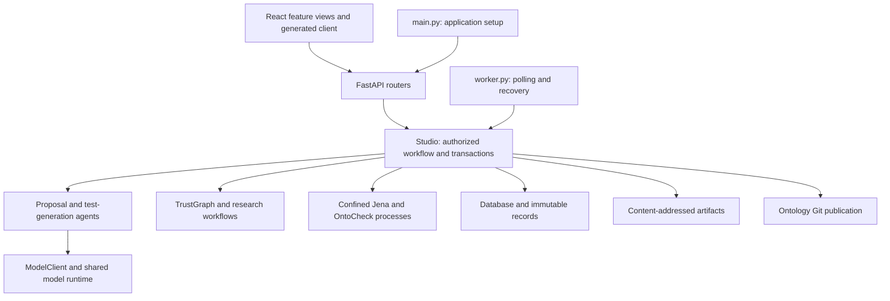

# Architecture and module boundaries

Studio has three runtime parts: the React UI, the Python API/worker, and confined
validation/assessment processes. The API and worker use the same workflow service,
database, immutable artifact store and ontology Git store. Source-code Git and
the user's ontology Git history are separate.

## HTTP boundary

`services/api/src/oe_studio/main.py` creates the application and its `Studio`,
installs exception handlers and middleware, controls the optional embedded worker,
and mounts the UI. The existing `create_app(settings)` and `main:app` entry points
remain available.

Endpoints live in `services/api/src/oe_studio/api/`:

| Module | Responsibility |
| --- | --- |
| `sessions.py` | Local operator bootstrap, team sign-in/sign-out and session responses |
| `health.py` | Liveness and readiness; no model generation |
| `projects.py` | Project discovery, scope, mappings, model catalog and audit reads |
| `sources.py` | Uploads, ingestions, frozen corpora, TrustGraph discovery, evidence and artifacts |
| `proposals.py` | Revisions, job submission, validation/assessment reads, oracle decisions, review and publication |
| `experiments.py` | Synthetic task registration, experiment jobs, D-stage linkage and sealed exports |
| `jobs.py` | Authorized job status and public model-configuration metadata |
| `dependencies.py` | Request-scoped `Studio` lookup and project-role authorization |
| `requests.py` | HTTP-specific request envelopes using core schemas and mapping contracts |
| `pagination.py` | Bounded cursor pages over already authorized records |

Routers contain no global `Studio`, database or settings instance. Their
`StudioDependency` resolves `request.app.state.studio`, so multiple applications
in one process retain separate sessions and stores. `project_actor` preserves
the existing route-name-based role rules; keep route names stable when changing
handlers, and exercise team-access tests for any new write operation.

HTTP adapters may depend on core schemas, response models and workflow services.
Core modules do not import `api/` or `main.py`. `schemas.py` holds shared domain
inputs; `api/requests.py` holds transport envelopes. In particular, keeping mapping
envelopes there avoids a cycle between core schemas and assessment contracts.

## Workflow and external boundaries

`workflow.Studio` coordinates authorization and transaction boundaries.
`create_job` authorizes and freezes inputs before enqueueing; `execute_job` claims
the lease, rechecks authorization, dispatches the operation and records completion
or failure. `_dispatch_job` selects the operation. `_authorize_job_profile` is the
shared check used before dispatch and before committing an effect/result.
`_complete_job` retains lease fencing and atomic result recording. These helpers
are internal, not extension points or a plugin registry.

Keep multi-record transactions together. Splitting `Studio` into mixins or moving
publication/recovery methods solely to shorten the file would obscure their shared
invariants. Further extractions should identify a cohesive responsibility with
explicit inputs and tests before changing these boundaries.

Proposal and test-generation agents own their bounded input/output contracts and
model-output checks. `llm_runtime.py` and `llm_profiles.py` own provider execution
and server-controlled configuration. Generation uses native OpenAI and Claude HTTP
requests; there is no provider-routing SDK layer. TrustGraph SDK details stay under
`integrations/trustgraph/`; `trustgraph_workflow.py` owns persisted import orchestration
and validates the server-owned binding configuration. Jena and OntoCheck retain
their independent confined execution paths and distinct result semantics.

The frontend remains organized by feature under `apps/studio-plugin/src/features/`.
Its API types are generated from the registered FastAPI routes. Run
`make check-api-contracts` after moving routes; regenerate contracts only for an
intentional API change. The response-contract tests inspect registered endpoints,
so job metadata coverage does not depend on their source-file location.

Model selection reuses this boundary: the shared native frontend selector reads
the sanitized project model catalog, filters profiles by operation and sends only
the selected profile ID. The server alone resolves credentials, authorizes the
choice and freezes the descriptor. Selections belong to individual actions;
repair inherits its origin unless explicitly overridden, and chat switches start
fresh conversations. No client-owned provider registry or credentials are added.
See [GUI model selection](multi-llm.md#choose-a-model-in-the-gui).

See the [workflow invariants](../AGENTS.md#workflow-invariants),
[integration evidence](integrations.md) and
[architecture cleanup verification](evidence/architecture-refactor-2026-11-02.md).
