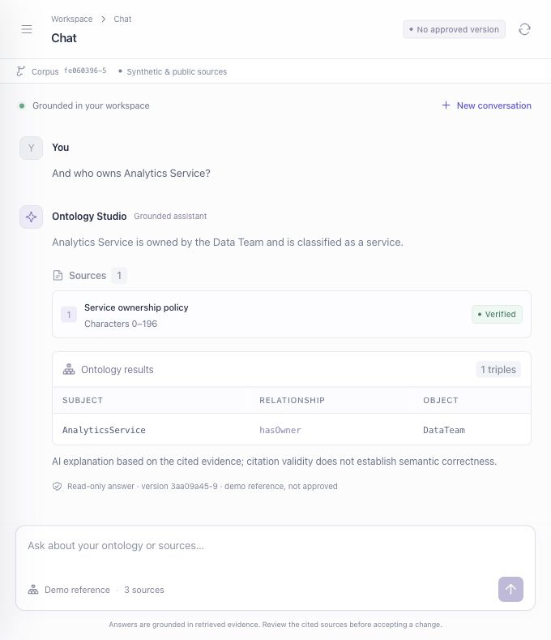

# Standalone browser verification

Verified on 1 November 2026 using the actual FastAPI server, built React application and local Ollama 0.40.13 / Qwen3 1.7B. The private operator fragment exchanged for a session and disappeared from the address bar. This is standalone evidence, not a TrustGraph portal smoke or a human study.

The question “Who owns Payroll Service, and how is it classified?” returned Operations Team and CriticalService, one verified source excerpt and the two relevant ontology triples. A subsequent “And who owns Analytics Service?” returned Data Team and the ownership triple. Both answers retained the reference-version label, indicated that the reference is unapproved, and left the approved head empty. No actual scope acceptance, expert approval or publication was performed by this verification.

The earlier deterministic browser exercise created an unapproved demo candidate and ran Jena validation. Subsequent engine/configuration changes intentionally make that historical bundle ineligible until a successor is created. Scope, mapping and seed-import component checks are separate from this chat smoke; complete live-host verification remains in `portal-smoke.md`.
