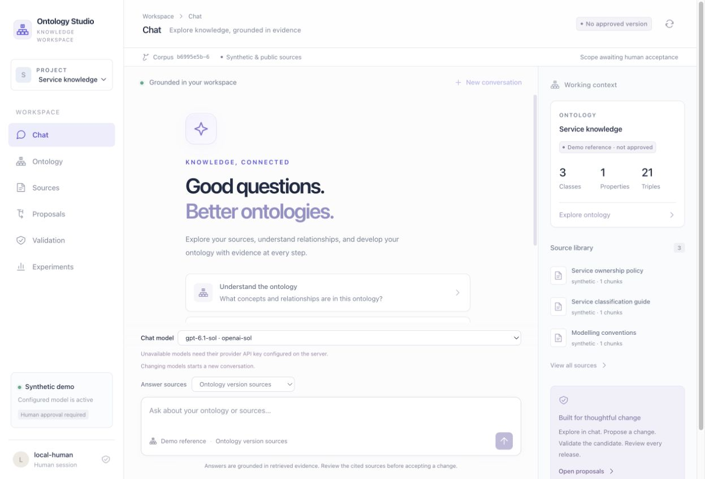

# GUI model selection verification — 3 November 2026

Studio now offers operation-specific GPT and Claude model selection in Chat,
proposal creation, repair, model test generation, model-pilot experiments and
registered-task experiments. The implementation uses the existing authorized
profile catalog and immutable job snapshots; no API contract or dependency was
added. Superpowers guided architecture, regression checks and independent review;
Ponytail guided the native shared frontend selector.

## Changes and boundaries

- The selector groups models by provider, filters purpose, uses only an authorized
  default, disables missing-key profiles and blocks failed/empty configured
  catalogs. Retry and project changes cannot retain a stale selection.
- Changing chat model clears the visible conversation and starts a new UUID.
  Repair defaults to original-model inheritance; only an explicit choice overrides
  it. Deterministic workflows omit model IDs.
- The example registry includes GPT-6.1 Terra/Sol, GPT-6 Astra/Luna and Claude
  Sonnet/Opus/Haiku 5.5. Their official references and configuration limits are
  recorded in [model configuration](../multi-llm.md#choose-a-model-in-the-gui).
- New Claude reasoning models can return passive `thinking` and
  `redacted_thinking` blocks. The runtime discards them and records only final
  text. Tools, refusals, unknown types, missing final text and truncation remain
  explicit failures. Claude examples retain prompt JSON because Studio's full
  schema constraints exceed Claude's native structured-output subset.

The ignored local registry was extended with six profiles, preserving the existing
Terra profile and default. Its sanitized catalog reports four OpenAI profiles as
`configured_unverified` and three Claude profiles as `missing_credentials`.
No dotenv values, original profile settings, credentials, working ontology,
approved artifacts or historical budgets were changed. Processes that have not
loaded the earlier dotenv configuration need to restart; the rebuilt UI needs a
reload. Presence of a key is not evidence of account access to every listed model.

## Automated verification

| Check | Result |
| --- | --- |
| Full backend suite with pinned Java 21 | **629 passed, 8 skipped**, 94.50 seconds |
| Frontend suite | **76 passed** across 15 files |
| TypeScript and standalone/plugin production builds | Passed |
| Ruff / `make lint` | Passed |
| `make check-api-contracts` | Passed; contracts unchanged |
| `git diff --check` | Passed |
| Independent code review, including final repair-label change | No actionable defects |

Backend output retained 3,415 dependency/collection warnings; eight opt-in checks
remain skipped (seven PostgreSQL checks and one live TrustGraph probe). The first
full run had 626 passes and three setup errors because the team test fixture read
the operator's `.env` model registry. The fixture now explicitly disables dotenv
and model configuration; its 12 tests passed, followed by the successful full
rerun above. The user configuration was not changed to make tests pass.

New checks cover multiple model IDs per provider through catalog pagination and
actual queued HTTP requests, exact frozen revisions, credential omission and
missing-key/unauthorized rejection. Runtime tests first reproduced valid Claude
thinking responses being rejected, then passed with the narrow allowlist change.
Frontend tests exercise selection payloads, unavailable/absent defaults, retry,
empty catalogs, project races, conversation changes and repair inheritance.
All model responses in this verification were controlled fixtures. Backend logs
and a compact result record are retained under
`.runtime/gui-model-selection-2026-11-03/`.

## Actual browser check

Chrome opened the rebuilt standalone UI against a disposable loopback API with
synthetic credentials and unreachable provider endpoints. The check inspected all
seven grouped model choices, confirmed the three Claude choices were disabled
with “API key missing”, changed chat to Sol, changed proposal creation to Astra,
and changed model-pilot experiments to Luna. Deterministic experiment mode did not
show a model selector. Browser console warnings/errors were empty. The disposable
database retained **zero jobs and zero projects with an approved ontology**.

This establishes UI wiring and controlled provider compatibility, not a paid
multi-model comparison, live Claude availability, a deployed TrustGraph-worker
upgrade or a full accessibility certification. No paid calls, approvals or
publication occurred. The disposable browser tab and server were closed.
