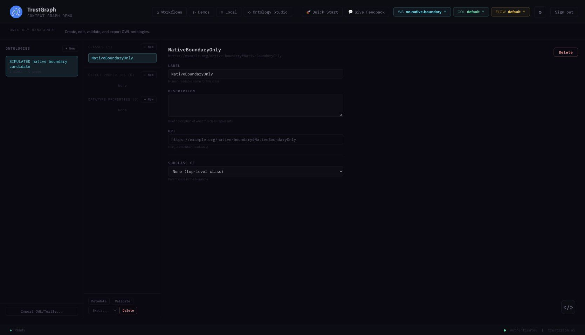

# Real native-editor boundary verification

On 2026-11-01 the actual pinned TrustGraph Ontology Management UI saved a new class in a fresh synthetic workspace. Studio's canonical artifact bytes, every Git file and ref, approved/pending heads, and canonical version/publication/review/audit records remained unchanged. This was checked for both the live main workspace and a disposable fixture with an authentic, populated approved release.

This is a simulated engineering test, not a study observation or real expert approval. The main Studio project retained its absent approved head and pending scope acceptance. No main review or publication action was performed.

## Actual mutation and authority

The unchanged portal at `127.0.0.1:5183` used the real 2.11.1 gateway at `127.0.0.1:18888`, with the source/image pins in [the host report](portal-smoke.md). Through its workspace selector, the test selected the fresh `oe-native-boundary` workspace, opened **Workflows → Ontology Management**, selected `SIMULATED native boundary candidate`, and clicked **Classes → New → Add** for `NativeBoundaryOnly`. The editor reported **Ontology updated**. A real `/config` read returned that class, and a reload followed by normal reauthentication showed it again.

The native editor's `OntologyWorkbench` calls the upstream `useOntologies` hook, which saves `type: ontology` configuration through `socket.config().putConfig`. That candidate configuration is a different store from Studio's content-addressed artifacts and canonical Git publisher. The native workspace selector does not grant Studio project or approval authority. No native store writeback/mirror is configured; an ontology exported from that editor must enter Studio as an unapproved seed/proposal and pass its scope, validation, assessment and exact-revision human review gates.



## Retained comparisons

The full before/after SHA-256 maps and release identifiers are in [the sanitized evidence packet](../native-editor-boundary-evidence.json).

| Target | Before and after result |
|---|---|
| Live main Studio | All **30 artifact files**, **18 Git files**, empty ref set, approved/pending heads and canonical record digest identical. |
| Populated disposable Studio | All **36 artifact files**, **28 Git files**, populated approved ref, approved/pending heads and canonical record digest identical. |
| Disposable approved ref | `refs/heads/2ddf433f-7594-47c7-bdd6-76fefb6728f6-approved` remained `9fc4d64ed7f0cfd190cb5cfe646292972243c690`. |
| Native candidate | Empty classes before; `https://example.org/native-boundary#NativeBoundaryOnly` after; native configuration digest changed. |
| Live publication API | Actual native JWT, without a Studio cookie, sent through the real portal to `POST /api/v1/projects/{main}/publications`: **401**. |
| Populated fixture publication API | The actual native JWT with the fixture's otherwise valid publication payload, through the real ASGI application without mocks: **401**. |

The populated fixture used the normal proposal → real Jena 6.2.0 validation → real OntoCheck 0.1.3 assessment → simulated scope/review decisions → publication workflow. All decision rationales explicitly say `SIMULATED ENGINEERING TEST` and exclude human-study observations. No automatic review timing was recorded. Engine identities, JAR hash, bundle digest, review/publication/version IDs and commit are retained in the evidence. The fixture was removed after verification; the fresh native workspace was disabled, and the host selection returned to `default`.

## Reproduce

Use the running local host/backend setup from [the portal report](portal-smoke.md), main Studio on port 8000, and the installed real Jena/OntoCheck engines. The script refuses to reuse an existing native workspace. Pick a fresh synthetic name for each run:

```sh
PYTHONPATH=services/api/src .venv/bin/python infra/portal/check_native_boundary.py prepare --workspace oe-native-boundary-new-run
```

In the actual native UI select the printed workspace, open its candidate ontology, and add class `NativeBoundaryOnly`. Reload and inspect it. Then:

```sh
PYTHONPATH=services/api/src .venv/bin/python infra/portal/check_native_boundary.py verify
PYTHONPATH=services/api/src .venv/bin/python infra/portal/check_native_boundary.py cleanup
.venv/bin/python -m pytest tests/contracts/test_native_boundary_snapshot.py -q
```

Private credentials and intermediate paths stay in ignored `infra/portal/runtime/`; the verification packet contains no credentials or session tokens. The small offline regression proves the snapshot comparison detects artifact bytes, extra Git refs, approved-head changes and canonical record changes. It is not substituted for the real UI/API exercise above.

This closes the local candidate-store/publication boundary subset of plan Tasks 1 and 8 / TODO-TG-06. It does not prove OS process/credential isolation, shared deployment identity/membership, an upstream read-only editor, arbitrary native feature coverage, or complete dataflow isolation. The same OS account can read local keys and files; shared deployment remains gated.
