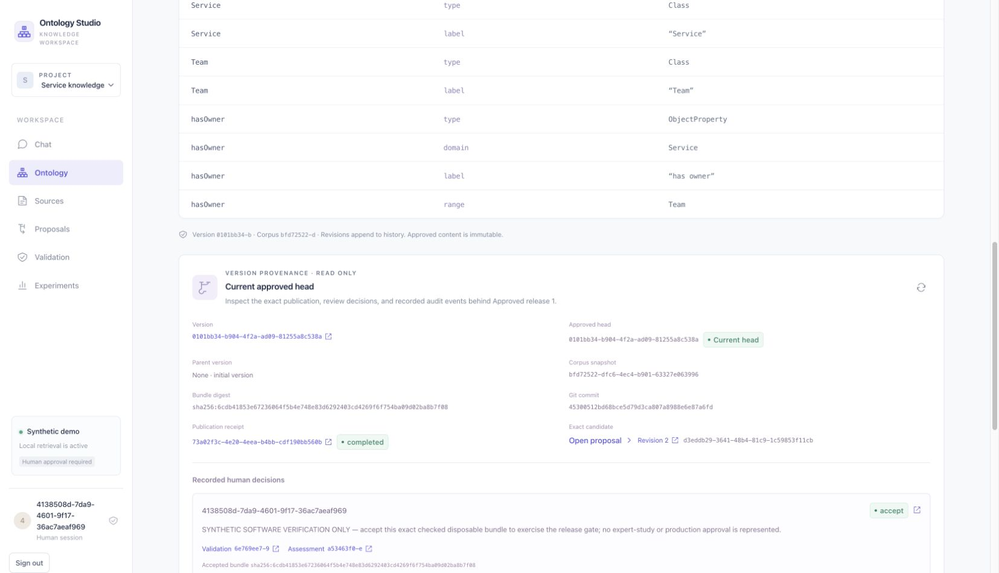

# Team browser workflow — synthetic software verification

Executed 2 November 2026 in actual macOS Chrome through the connected browser extension, against a disposable PostgreSQL team deployment. This was a software verification exercise with simulated human decisions, not an expert study, participant record, or approval of a working ontology. The repository’s `.data` and `.env` were not used.

## Runtime and reproduction

[Runtime helper](../../scripts/team_browser_smoke_runtime.py) starts the pinned PostgreSQL 17.6 image with a unique ownership label and loopback-only port 55436, migrates to `0002`, creates four separate project memberships, and starts API (8016), worker, and Vite (5186) as separate processes. Jobs were non-eager and the API embedded worker was disabled. A private temporary directory held the database connection settings, application data and process logs. The helper constructed a controlled environment, used no model URL/name/key or profile configuration, and did not read the working `.env`. No paid model calls were made.

Run from the checkout with the pinned Python environment and Docker available, outside a restrictive parent process sandbox so the application’s own macOS engine isolation can execute:

```sh
.venv/bin/python scripts/team_browser_smoke_runtime.py start
# The command prints the owned private runtime directory and loopback UI origin.
# Exercise the actual UI with the explicitly synthetic accounts provisioned by the helper.
.venv/bin/python scripts/team_browser_smoke_runtime.py snapshot --private-runtime /path/printed/by/start
.venv/bin/python scripts/team_browser_smoke_runtime.py stop --private-runtime /path/printed/by/start
```

The helper refuses occupied ports and removes only its ownership-labelled container. Do not substitute the working application’s data directory. The fixed browser-only credentials are in the helper; do not use these accounts or credentials for a shared deployment.

## Actual browser actions and results

1. Unauthenticated access displayed the team username/password form. Signed in as `browser-approver` and opened Sources. Chat generation, source upload and corpus mutation controls were disabled for this role. Accepted the exact synthetic scope with a rationale explicitly labelled **SYNTHETIC SOFTWARE VERIFICATION ONLY**, then signed out.
2. Signed in separately as `browser-researcher`, generated the deterministic service ontology candidate and inspected its grounded sources and immutable revision. The separate worker completed the queued proposal job. No model was configured or called.
3. Opened Validation and selected the default deterministic development-test generator. The worker produced a suite containing 18 suggested ASK, typed SELECT and SHACL tests. The UI preserved their proposed expectations, scenario/input identities, fixtures, and limitations; researcher oracle acceptance controls remained disabled.
4. Signed out, then signed in as `browser-reviewer`. Accepted the exact suite with another explicitly synthetic rationale. This produced immutable revision 2 and retained the fresh validation, assessment and release-review gates. Researcher check controls were disabled for the reviewer. [Successor screenshot](../screenshots/team-2026-11-02/reviewer-successor.jpg).
5. Signed back in as `browser-researcher`. Ran actual **Apache Jena 6.2.0** validation: the original two competency questions and all 18 accepted development cases passed. The report retained the RDFS/SHACL and false-ASK limitations. Ran the actual isolated **OntoCheck 0.1.3**, commit `69d42e38979f381fe531ae547fcc49b8ad58ef15`, assessment: status completed; task-vocabulary coverage 100%, vocabulary utilisation 50%, strict fitness 100%, approximate fitness 100%. The recorded engine manifest identifies macOS Seatbelt kernel network denial, isolated Python 3.12.14 and package/resource identities. These metrics measure the synthetic task and do not establish source fidelity, general ontology quality or expert evaluation. Submitted revision 2 for human review. [Jena screenshot](../screenshots/team-2026-11-02/jena-passed.jpg).
6. Signed in separately as `browser-approver`. Researcher validation/assessment/submission controls were disabled. Entered a rationale explicitly stating this was disposable software verification, accepted the exact checked bundle, and separately clicked Publish version. The backend published exactly one approved release. The ontology provenance displayed the exact candidate, review, checks, completed receipt and Git commit.
7. Signed in as `browser-viewer`. New proposal, validation and assessment buttons were verified disabled while the published candidate remained readable. Signed out and reloaded; the empty team login form returned. No password was saved to browser storage by the application. [Viewer screenshot](../screenshots/team-2026-11-02/viewer-read-only.jpg).

No review timer was started and no correction time or study observation was invented. All mutations above used the visible application controls; the only database access after the workflow was a read-only sanitized evidence export.

## Exact publication evidence

| Identity | Value |
| --- | --- |
| Project | `a95973e1-cf44-4efa-a81a-3f4839ba6cbc` |
| Proposal | `1ef71c88-68b4-4cb8-b2b1-b59dc462b20f` |
| Checked revision | 2 · `d3eddb29-3641-48b4-81c9-1c59853f11cb` |
| Bundle | `sha256:6cdb41853e67236064f5b4e748e83d6292403cd4269f6f754ba09d02ba8b7f08` |
| Validation | `6e769ee7-9beb-40de-87e4-814ac8268c32` |
| Assessment | `a53463f0-e224-46a8-9ae9-c31c60b12bdc` |
| Release review | `6671edc1-d682-4fe8-9601-c0418761d6b4` |
| Publication | `73a02f3c-4e20-4eea-b4bb-cdf190bb560b` · completed |
| Approved version | `0101bb34-b904-4f2a-ad09-81255a8c538a` |
| Git commit | `45300512bd68bce5d79d3ca807a8988e6e87a6fd` |



[Sanitized machine evidence](team-browser-2026-11-02.json) records migration, separate account subjects/memberships, immutable revisions, reviewer oracle decision, real engine manifests/results, approval, publication and four succeeded worker jobs, each with one attempt. It excludes passwords, connection credentials, cookies, CSRF values, session identifiers and raw transport logs. The final project has no pending publication.

## Failures, cleanup and limits

The initial runtime helper readiness probe used `/health` instead of `/health/live`; startup was treated as failed and its owned runtime was cleaned up before retry. The helper was corrected. One exact-label browser locator timed out on the proposal instruction field; a fresh accessibility observation showed the unchanged form, and the supported native field action succeeded. No proposal write was retried or duplicated.

The final owned API, worker and frontend process groups were stopped and the labelled PostgreSQL container removed. A separate host check found no listeners on 8016, 5186 or 55436 and no remaining labelled verification container. Private disposable data and logs were removed after export; retained artifacts contain sanitized evidence and screenshots only.

This verifies the deterministic team publication path with real engines and PostgreSQL in an actual browser. It does not establish live model-provider compatibility, model-generated test quality, reverse-proxy/TLS production deployment, concurrency/load behavior, every permission-denial endpoint, cross-project membership changes, or a complete accessibility audit. Those require their own evidence.

A subsequent cleanup-helper review added ownership validation before any process signal, stored process start-time/command fingerprints, all-process preflight plus immediate fingerprint rechecks before signalling, and idempotent handling of stopped or removed runtime state. A mismatched or unverifiable process is left untouched. Five focused unit tests passed for wrong container ownership, stopped/removed state, stale PID reuse, matching/missing processes, and fingerprint collection without environment output. Helper Ruff and patch-hygiene checks passed. This cleanup-only hardening was verified with mocked process boundaries; the browser workflow was not rerun or represented as a second execution.
