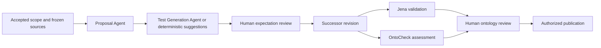

# Two-agent Studio development

The accepted 2 November 2026 scope is two independently testable ontology agents, operator-provisioned team accounts, and independent frontend/API/worker processes in this repository. Verification uses disposable synthetic data on Mac. Ubuntu engine isolation, repository splitting, DORA runtime activation and participant research remain deferred.

## Boundaries

- Proposal Agent: requirements, source evidence and permitted repair feedback produce cited changes. Existing experimental A–D feedback restrictions remain unchanged.
- Test Generation Agent: a frozen candidate and evidence produce bounded declarative suggestions. Human reviewers decide expectations; acceptance produces a successor revision with fresh checks.
- Backend: durable queue, immutable artifacts, engine execution, access checks, review and publication. Agents have no approval or publication capability.
- Team accounts: operator-created username/password accounts, Argon2 hashes, revocable sessions, CSRF and exact-origin checks, project memberships. Viewer reads; researcher drafts and runs jobs; reviewer decides expectations and non-acceptance reviews; approver accepts scope/releases and publishes. A user may hold multiple roles.

## Implementation and verification

- `services/api/src/oe_studio/agents/proposal.py` owns the versioned, explicit proposal/repair input contract and cited change output; `agents/test_generation.py` owns bounded model test suggestions. Both accept an injected shared model client and have no persistence or execution authority.
- Test-generation jobs freeze inputs and selected profiles, preserve separate provenance, recheck scope/permission/context on completion and retain failures without fallback. The existing test-review screen exposes deterministic/model mode and profile selection. Old clients remain deterministic.
- Team accounts, project permissions, migration/CLI support and independent process startup are implemented. Team generation requires accepted scope; local demo behavior is preserved. See [operator commands](operations.md#team-development-on-mac).
- Full backend, frontend, PostgreSQL restore, worker recovery and actual-browser verification are recorded in the [dated report](evidence/two-agent-team-2026-11-02.md). The actual browser flow used separate named roles, real Jena/OntoCheck and one disposable release.
- The controlled development comparison detected four of four mutants without false positives on three valid variants. Model generation is configured through API profiles; local Qwen setup and execution have been removed at the user’s request. No paid/remote model calls or expert study decisions were made.

## Decisions

Work stays in the current checkout as instructed. Team mode uses PostgreSQL; SQLite is retained for local demo and explicitly isolated tests. New projects require an existing researcher membership, and their creator receives only the researcher role; an operator assigns review/approval roles. No paid provider calls are authorized for this work. Existing source packets, artifacts, approvals and research evidence are preserved.
