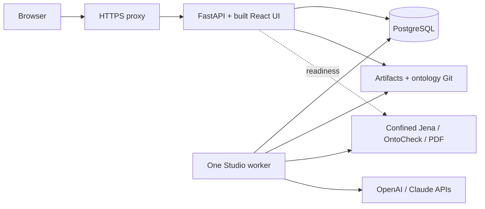

# Ubuntu deployment and migration plan

> **For agentic workers:** The private setup is complete. Checked items have evidence linked below; unchecked team, preservation and capacity tasks are deferred and are not instructions to expand the deployment.

**Date:** 3 November 2026.
**Status:** Fresh private Ubuntu setup is running and verified locally. The user revisited the preservation choice and explicitly chose fresh synthetic data and private SSH-tunnel access. No Mac transfer is part of the active work. [Completed setup and limits](evidence/ubuntu-private-setup-2026-11-03.md).
**Goal:** Run a fresh synthetic Studio on the user's Ryzen 7945HX Ubuntu 26.04.1 test server, initially on loopback through an SSH tunnel, leaving the Mac installation untouched.
**Architecture:** The running private setup has FastAPI with the built React UI, one independent worker and fresh SQLite storage, accessed through an SSH tunnel. Jena, OntoCheck and PDF extraction run as confined child processes. Models are unconfigured, so generation uses the labelled deterministic demo. The optional team target adds an HTTPS proxy and PostgreSQL.
**Tech stack:** Ubuntu 26.04.1, systemd user services, Python 3.12.14, uv/locked dependencies, Java 21, SQLite, React production assets and Linux Bubblewrap confinement. Nginx and pinned PostgreSQL 17.6 are prepared options for later team deployment.
**Spec:** The [deployment design](#deployment-design) in this document, updated by the [live host inspection](evidence/ubuntu-host-inspection-2026-11-03.md). Test-only purpose is user supplied; the topology, resource budgets and rollout choices below are recommendations.

## Active setup decision — 3 November follow-up

The user explicitly selected **Fresh Ubuntu setup** and **Private access through an SSH tunnel**. The initial installation uses local identity, a fresh SQLite store, the production UI and confined engines. Bind the API only to `127.0.0.1:8000`; do not expose local identity on LAN/public interfaces. No model profile or credential is required for the labelled deterministic demo. Build and test with repository-local pinned runtimes, preserving existing system tools, PostgreSQL and the unrelated app on port 8080.

The four-service team topology and HTTPS/systemd templates below remain prepared options, not the selected initial deployment. Do not install the team proxy/database or provision team accounts for this private phase. No Mac source access or backup is needed. The preservation investigation below is retained as a superseded alternative and does not authorize transfer or changes to either source store.

- [x] Install pinned Linux tools alongside system runtimes and build Jena/both production UI bundles.
- [x] Implement and test Linux confinement, resource supervision and engine fingerprint invalidation.
- [x] Verify full backend/frontend checks, real browser workflow and disposable SQLite restore.
- [x] Start and enable loopback API plus independent worker user services against a clean synthetic store.
- [x] Save private session access and operation instructions; retain Mac and unrelated host services untouched.

The user's client-side SSH tunnel, reboot and capacity tests remain unverified. The deferred team tasks below retain their own acceptance gates.

## Superseded preservation investigation — reference only

The user initially selected **preserve existing Mac projects and history** after cloning the source into `/home/mjli/projects/HITLOntologyAgent` on `ms02`, then superseded that choice with the fresh setup above. At inspection, the clean checkout was commit `73166584ba3d5f8448dd1a704a4f348f7c006a13`; `.env`, `.data`, `.runtime`, Python environments and built assets were absent. A source clone is not an application-state backup. [Historical investigation](evidence/ubuntu-migration-readiness-2026-11-03.md).

The recommended first migration preserves the source database type. Its type, configured data directory, source revision and backup location still need inspection on the Mac; the old chat's checkout path is `/Users/snuffred/Repository/HITLOnotloy`, not proof of the active data directory. Only `ms02` was available through the connected device list during this investigation.

| Actual source | First restore | Deployment consequence |
| --- | --- | --- |
| Local SQLite | Consistent SQLite backup plus artifacts and `ontology.git` | Keep local identity on loopback; use an SSH tunnel for remote browser access. A later team conversion is separate work. |
| Team PostgreSQL | Version-compatible database dump/restore plus coordinated artifacts and `ontology.git` | Retain team mode and existing account/project identities; use the four-service HTTPS topology below after verification. Confirm database-version compatibility before choosing the target image. |

`make migrate` applies schema migrations; it does not transfer rows between machines or convert SQLite to PostgreSQL. No SQLite-to-PostgreSQL conversion utility exists in the current repository. Do not point the restored artifact/Git directories at a newly seeded empty database. New synthetic stores in Tasks 3–5 are disposable verification fixtures, never replacements for the user's store.

### Deferred alternative: Preserve, rehearse and verify a source store

**Files/tools:** Existing `scripts/backup_restore.py`, `scripts/migrate.py`, `services/api/src/oe_studio/settings.py`, `services/api/src/oe_studio/workflow.py`, and [operations](operations.md). Record private inventory/backup manifests outside Git; append sanitized observations to the migration evidence report.
**Consumes:** Access to the Mac store or a protected existing backup, plus the user's preservation requirement.
**Produces:** An untouched rollback copy, a verified Ubuntu restore in a new directory/database, and an explicit cutover record. Linux runtime preparation can proceed independently; starting restored jobs depends on Task 2.

- [ ] Inspect the source configuration without printing credentials: actual data directory, database type/version, local/team mode, source commit and local code changes, private profile/provider paths, project IDs, pending jobs and publication reservations. Preserve existing project IDs and account memberships.
- [ ] Inventory state outside the database: artifacts, bare ontology Git, private model/provider registries, retained `.runtime` budget/evidence files and `research/results` seals/exports. Preserve relevant original documents separately. Do not copy macOS environments, caches or executable runtimes as Linux installations.
- [ ] For a rehearsal backup, stop source writers and let bounded work finish. Account for unresolved jobs/publications explicitly; never reset their status or replay uncertain model calls merely to make the destination run. Use a fresh private backup destination and retain the source unchanged. Resume source use only after the snapshot is complete; a later cutover requires a new final snapshot.
- [ ] For SQLite, use `scripts/backup_restore.py backup --data-dir <actual-source-data> --destination <new-private-backup>` with the source Python environment, then `restore` into a nonexistent target directory. The utility copies the whole SQLite database, artifacts and bare ontology Git, verifies content hashes/integrity/refs, and excludes `session.key`. It does not package `.env`, external profile files, research outputs or budget ledgers; transfer these separately over an authenticated private route.
- [ ] For PostgreSQL, use version-compatible `pg_dump`/`pg_restore` and artifact/Git copies from the same stopped-writer window. Restore to a new database and directory. Never replace the server's existing PostgreSQL 18/16 clusters. The plan's pinned 17.6 container is suitable only after source-version compatibility is established; do not attempt an unreviewed downgrade from a newer source database.
- [ ] Before launching Studio or applying schema changes, compare all source/restored database tables, IDs and job states; compare artifact bytes/hashes, Git refs and approved-version links; run database integrity checks and `git fsck`. The SQLite helper's logical summary covers projects and workflow items, so add explicit checks for jobs, accounts/memberships and other tables. Preserve the original manifest before migrations can change the database.
- [ ] Prepare Linux paths in a private configuration while preserving project allowlists, model defaults and historical frozen settings. Retain API/worker configuration parity and smoke-budget history. Create a fresh local session key on first local startup; for team mode, preserve accounts/roles and handle session revocation deliberately through supported commands. Never copy credentials into documentation or rewrite old generation/experiment records.
- [ ] Complete Linux engine verification on disposable synthetic stores first. Compare the restored project list, source snapshots, proposal history, audit records, experiments and approved Git heads before enabling work. Mac engine fingerprints remain historical: pending candidates require successors and fresh checks/review under Linux; do not edit manifests or reuse stale approval to bypass this gate. Never test publication against the migrated working store.
- [ ] At cutover, stop Mac writers, take and verify the final coordinated snapshot, restore into a new Ubuntu target and keep only one active writer installation. Start the API first with the embedded worker disabled; inspect restored jobs/reservations before starting the independent worker. Retain the Mac backup as rollback. If Ubuntu has accepted writes, rollback requires reconciliation rather than silently starting the older Mac snapshot.

**Acceptance:** Source/restore parity demonstrated before startup, historical approved refs and immutable bytes retained, no unplanned job/model/publication effects, and an explicit rollback point. No source store or backup was available to verify in this investigation.

## Deployment design

**Recommendation: put all core Studio components on this server.** Live inspection confirmed 16 CPU cores / 32 threads, 12.84 GiB kernel-visible RAM, approximately 10.95 GiB available memory and 751 GiB free NVMe space under light current load. This supports the proposed synthetic test deployment, but is not an application benchmark or a promised user capacity. The initial user-reported Ubuntu 24.04 / 16 GB description is superseded for sizing by these observations; the reason for lower usable RAM was not investigated.

### Approaches considered

| Approach | What runs here | Tradeoff |
| --- | --- | --- |
| Core Studio first — optional team target | Four persistent application services plus on-demand engines | Complete standalone workflow with the most RAM headroom; Linux confinement is now implemented |
| Core plus full TrustGraph | Core plus seven additional containers, embeddings and optionally the portal host | Useful for integration tests, but tight on the measured 12.84 GiB and adds platform/identity/configuration work |
| Core here; TrustGraph on another machine later | Same core deployment with a separately verified remote integration | Preserves local RAM; requires another host and explicit integration/transport configuration |

The first approach remains the proposed team deployment; the running private setup uses only API and worker services with SQLite. Other approaches remain options, not agreed purchases or additional work. Ubuntu 26.04.1 and existing system tools were retained. The initial Python/Node/uv/Java version gaps were resolved with pinned checkout-local runtimes; see [installed versions](evidence/ubuntu-private-setup-2026-11-03.md). [Initial live versions](evidence/ubuntu-host-inspection-2026-11-03.md) and [follow-up observations](evidence/ubuntu-migration-readiness-2026-11-03.md) remain historical evidence.

### Component count

Count application services, not every OS daemon, thread or container subprocess:

| Component | Persistent service? | Placement |
| --- | --- | --- |
| Nginx HTTPS entry point | 1 | Proposed new service; forwards the same origin to Studio |
| FastAPI + compiled React UI | 1 | Existing app serves `apps/studio-plugin/dist`; no separate Vite server |
| Studio job worker | 1 | One process initially; proposal and test-generation agents are modules, not separate servers |
| PostgreSQL | 1 | Existing pinned Compose image; required for normal team mode |
| Jena validation | No | Confined Java process per invocation; no Fuseki server |
| OntoCheck assessment | No | Confined Python process using its separate environment |
| PDF extraction | No | Confined Python process per extraction |
| Artifacts and ontology Git history | No | Persistent directories; Git CLI, not a Git hosting service |
| OpenAI / Claude | External | Existing API integrations; no local generation model or GPU requirement |

**Total: four persistent application services, plus three on-demand engine types.** Readiness also invokes Jena/OntoCheck and can overlap worker activity. PostgreSQL supplies the durable job ledger; Redis, Celery and Kubernetes are unnecessary for this topology.

Evidence: [static UI mount](../services/api/src/oe_studio/main.py), [worker loop](../services/api/src/oe_studio/worker.py), [team settings](../services/api/src/oe_studio/settings.py), [database Compose](../infra/compose.yaml), and [architecture](architecture.md).

### Capacity budget

These are initial **planning allowances**, not measured consumption. API/worker cgroup limits are now configured at the corresponding values; the database/proxy remain deferred. Revisit allowances after capacity testing:

| Use | Approximate RAM allowance |
| --- | ---: |
| Existing OS, Docker and light workloads | 2 GiB |
| New API, HTTPS proxy and readiness engine peaks | 1.5 GiB |
| One new worker including its engine children | 3 GiB |
| New isolated PostgreSQL | 1.5 GiB |
| Remaining nominal headroom within observed 12.84 GiB | About 4.8 GiB |

This revised budget allows approximately 6 GiB for new Studio services. The observed baseline is a momentary snapshot; existing workloads can grow. Re-measure before installation and keep the 3 GiB steady-load available-memory target below. Build during a quiet window. The observed 751 GiB free disk exceeds the initial 50 GiB operational allowance for dependencies, images, data and a restore copy; this is not a measured application minimum. Keep a protected backup on another machine/disk as well. Source/artifact retention determines long-term storage use.

The private setup uses one worker and one Uvicorn process. More CPU cores do not justify automatically starting many memory-consuming workers. Jena retains its 256 MiB heap, 128 MiB metaspace, two active processors and 30-second deadline; its process tree now has a sampled 1 GiB RSS ceiling. PDF uses 512 MiB and 15 seconds. OntoCheck uses 1 GiB and a default 20-second deadline (maximum 60 seconds). Task/output limits and descendant cleanup also apply; sampling permits transient overshoot. [Actual limits and verification](evidence/ubuntu-private-setup-2026-11-03.md), [Jena](../services/api/src/oe_studio/validation.py), [PDF](../services/api/src/oe_studio/pdf_ingestion.py), [OntoCheck](../services/api/src/oe_studio/assessment.py).

### Why TrustGraph comes later

The checked-in base Compose has RabbitMQ, Cassandra, control and gateway. Its pipeline overlay adds Garage, Qdrant and pipeline: **seven additional containers**, or eleven persistent application services when combined with the proposed core. An embedding service and separately served portal can increase that count. The API-profile overlay replaces the pipeline service rather than adding another container. [Base Compose](../infra/portal/compose.yaml), [pipeline overlay](../infra/portal/pipeline.compose.yaml), [profile preparation](../infra/portal/prepare_llm.py).

Their declared container memory caps total 7.25 GiB, excluding core Studio, embeddings, portal, OS and build/cache overhead. A sum of caps is neither actual usage nor a proven capacity requirement. Current upstream guidance asks for 12 GB or more and eight CPUs available to TrustGraph itself. That makes simultaneous full-stack testing on this host with 12.84 GiB usable RAM a later measurement exercise, not the default. [TrustGraph quickstart](https://docs.trustgraph.ai/quickstart/).

Before adding it, verify amd64 image pins: the exercised TrustGraph digest is recorded as arm64. Resolve the historical `host.docker.internal:11434` embedding endpoint for Linux; current API completion does not replace embeddings. Rebuild the current API-profile worker instead of activating retired Qwen generation tooling. Verify portal routing/identity, provenance and all persistent stores separately. [Image metadata](../infra/portal/source-pins.json), [pipeline generator](../infra/portal/prepare_pipeline.py), [current integration](trustgraph-multi-llm.md), [remaining integration gates](integrations.md).

## Global constraints

- Scope is a trusted test deployment using synthetic data. No real study, confidential ingestion or organizational production claim follows from this plan.
- Preserve the current checkout's unrelated changes, private configuration, approved ontology history, immutable artifacts, audit records and historical evidence. Use disposable stores for verification and a separate fresh store for the selected private setup. The superseded source-preservation alternative is not active work.
- Keep Python 3.12.14 and repository lockfiles, Java 21+, and OntoCheck in its isolated environment. Build for Linux/amd64; do not copy macOS virtual environments or native binaries.
- Models and retrieval never approve publication. Preserve exact immutable-bundle checks, human role decisions, A–D controls and successor requirements.
- A missing/broken sandbox must fail closed. No `isolation=off` workaround or unconfined fallback; Docker around the existing app alone does not implement Linux engine isolation.
- Keep the selected SQLite/local setup on loopback through an SSH tunnel. A later shared deployment requires team mode, PostgreSQL, an exact HTTPS origin and explicit account/project roles; it is not implicit in this private setup.
- No paid model calls are part of initial verification. Use deterministic demo or controlled endpoints explicitly configured for disposable tests; never switch a failed configured model to demo.

## Review focus

1. The actual Ubuntu 26.04.1 AppArmor/user-namespace restrictions: a denied launcher must produce an explicit failure (Task 2).
2. Host-filesystem, network, symlink/hard-link and descendant escapes: real Linux boundary tests must fail to access forbidden resources (Task 2).
3. HTTPS proxy/origin/session handling and cross-project access: test through the browser's actual entry point (Tasks 3–4).
4. Restart or interrupted model calls/publication: retain leases and uncertain-call failures without duplicated effects (Task 4).
5. Memory pressure and database/artifact/Git restore consistency: measure overlap and restore to a fresh target (Tasks 4–5).

## Task 1: Record the target and prepare a reproducible release

**Files:** `Makefile`, `.python-version`, `.node-version`, `.github/workflows/ci.yml`, lockfiles and `infra/compose.yaml`. Observed results are in [the completed setup report](evidence/ubuntu-private-setup-2026-11-03.md).
**Consumes:** The user's host specification and current source checkout.
**Produces:** A sanitized host inventory and a release identity suitable for repeatable Linux installation.

- [x] Record the host architecture/OS, CPU, memory, disk, existing workloads and listening ports. See the dated live inspection; recheck volatile resource/port values immediately before installation.
- [ ] Select the test hostname/access route and certificate method: a trusted internal certificate for LAN access or a valid certificate for the chosen DNS name. Preserve existing server services and port assignments.
- [x] Record the exact source baseline plus the intentionally included uncommitted Ubuntu patch in the setup report; the initial checkout was clean.
- [x] Build Jena and production UI with checkout-local Python 3.12.14, Node 26.13.0, uv 0.13.6, Maven 3.10.0, Java 21.0.13+9 and locked dependencies. Services run without reload or a Vite development server.

**Acceptance:** Reproducible Linux build and documented host baseline. Successful build alone does not satisfy engine readiness.

## Task 2: Implement and prove Linux engine confinement — completed locally

**Files:** Modify `services/api/src/oe_studio/engine_isolation.py`, `tests/test_engine_isolation.py` and `.github/workflows/ci.yml`; add `tests/probes/linux_network.py`. Adjust the three engine wrappers only where Linux launch/resource handling requires it. Add a scoped AppArmor deployment profile under `infra/ubuntu/` if host verification requires one.
**Consumes:** Existing `isolated_command(command: list[str], *, workdir: Path, readable: list[Path]) -> tuple[list[str], dict]` and `isolation_configuration() -> dict` contracts.
**Produces:** The same interfaces with verified Linux support and distinct, stable policy/runtime metadata included in the engine fingerprint.

At the investigation baseline, the code accepted only macOS Seatbelt and rejected Linux. The Linux launcher and aggregate resource supervisor are now implemented and exercised on Ubuntu 26.04.1; remote CI/Mac reruns remain unverified. The original acceptance checklist below describes the engineering task; the [completed evidence](evidence/ubuntu-private-setup-2026-11-03.md) records exactly what ran. [Launcher](../services/api/src/oe_studio/engine_isolation.py), [readiness](../services/api/src/oe_studio/health.py), [CI configuration](../.github/workflows/ci.yml).

- [x] Exercise declared read/write boundaries, secrets/approved-store denial, symlink/hard-link escapes, native TCP/UDP and descendants, and fail-closed launcher behavior on Linux. Assert actual boundaries rather than Mac-specific errno values.
- [x] Implement `linux-bubblewrap` with minimal system mounts, read-only declared inputs, one writable scratch area, isolated host/external networking, cleared environment and fingerprinted policy/launcher identity. Sandbox-local loopback, proc and dev remain available.
- [x] Make engine metadata and boundary tests platform-aware while retaining the Mac launcher and historical reports.
- [x] Verify the application policy on the actual Ubuntu 26.04.1 host with Bubblewrap 0.11.1 and existing AppArmor settings. No global namespace/AppArmor relaxation was required.
- [x] Exercise sampled aggregate memory/process/output ceilings, wall deadlines and complete descendant cleanup on timeout, cancellation and normal exit.
- [x] Replace PDF launcher-only RSS accounting with shared descendant supervision; bound Jena/OntoCheck streams and report artifacts.
- [x] Pass the complete Ubuntu backend suite, including real engines and benchmark compatibility; include supervision changes in the engine fingerprint and extend CI to Ubuntu while retaining Mac coverage. Remote CI and live Mac execution remain unverified.

**Verification:** `.venv/bin/python -m pytest tests/test_engine_isolation.py tests/test_validation.py tests/test_assessment.py tests/test_pdf_ingestion.py tests/test_benchmark_compatibility.py -q`, followed by affected workflow tests. A skip or sandbox failure is not acceptance.

## Task 3: Install the four-service test topology — deferred team option

**Files:** Create `infra/ubuntu/ontology-api.service`, `infra/ubuntu/ontology-worker.service`, `infra/ubuntu/nginx.conf` and a secret-free `infra/ubuntu/studio.env.example`. Add an Ubuntu section to `docs/operations.md`. Retain `infra/compose.yaml`'s pinned PostgreSQL image.
**Consumes:** Task 2's verified Linux release and Task 1's hostname/certificate choice.
**Produces:** One HTTPS origin serving the built application, one worker and persistent PostgreSQL/storage for team mode. Verify it with disposable data first. A later change from the selected private SQLite setup requires a separate state-transfer decision; never seed over existing history.

- [ ] Install the release under `/opt/ontology-studio/`, private configuration under `/etc/ontology-studio/`, and fresh test data under `/var/lib/ontology-studio/`. Run application processes as a dedicated non-root account. Keep private secrets outside release artifacts and engine mounts.
- [ ] Start the separately pinned PostgreSQL 17.6 container with its named volume, localhost port 54329, private generated password and restart-on-boot policy. Preserve existing native PostgreSQL 18 on port 5432, the stopped PostgreSQL 16 cluster and existing Docker data. Record the new volume location. Migrate only Studio's new database before starting API/worker; service restart must not perform uncontrolled schema changes.
- [ ] Set `OE_MODE=team`, `OE_DATABASE_URL`, `OE_DATA_DIR`, `OE_TEAM_ORIGIN=https://<chosen-host>`, `OE_EMBEDDED_WORKER=false`, Linux Java/OntoCheck paths and `OE_ENGINE_ISOLATION=linux-bubblewrap`. Supply identical relevant private configuration to API and worker. Keep insecure-loopback/test-SQLite flags off.
- [ ] Configure systemd to start Uvicorn on `127.0.0.1:8000` and `python -m oe_studio.worker` separately with the repository working directory and `PYTHONPATH=services/api/src`. Apply compatible resource/service restrictions; allow bounded jobs to finish on shutdown and preserve crash recovery. Validate restart-on-boot behavior.
- [ ] Configure Nginx for the single HTTPS origin, preserving `/api/v1` paths, Host and Origin. Trust forwarded headers only from the loopback proxy. Accommodate the existing 20 MiB upload limit plus multipart overhead. Test the certificate, secure cookies, CSRF and proxy request/timeout limits.
- [ ] Provision synthetic test accounts/project roles using `account_cli` only in the disposable environment. For the migrated store, retain existing accounts/roles and inspect them before any operator changes. Configure project-authorized model profiles on the server only when required; catalog/readiness checks must not generate billable requests.

**Acceptance:** `systemd-analyze verify` for units and `nginx -t` pass; liveness/readiness succeed; the UI loads via HTTPS; the worker drains a controlled synthetic job; reboot restores services. Validate through the real proxy, not only direct loopback requests.

## Task 4: Verify the full synthetic workflow and recovery

**Files:** Existing `tests/integration/test_team_access.py`, `test_worker_process.py`, `test_real_engine_workflow.py`, `test_workflow.py` and contract suites; add focused deployment regressions only where new behavior lacks coverage. Record actual evidence in Task 1's report.
**Consumes:** The running disposable team environment.
**Produces:** Evidence of Ubuntu workflow correctness, recovery and coordinated restore.

- [ ] Run relevant unit/contract/integration suites plus frontend tests/build, `make lint`, `make check-api-contracts` and `git diff --check`. Retain actual passes, failures and skips.
- [ ] Perform browser checks for login, project denial, CSRF, text/PDF sources, proposal/test generation, real Jena/OntoCheck results and exact-bundle review. Use controlled model responses. A manual review requires a real tester decision; automated approvals/publication fixtures stay in separately labelled disposable test stores.
- [ ] Verify no paid provider traffic during controlled tests. Model failures remain explicit. Record any later live-provider probe separately with its own authorization/bounds; readiness is not such a probe.
- [ ] Exercise graceful worker stop, abrupt interruption and publication recovery. Demonstrate no automatic replay of an uncertain external call and no duplicate publication effect.
- [ ] Stop writers; back up PostgreSQL with version-compatible `pg_dump`, plus artifacts and ontology Git from that same maintenance window. Protect configuration separately. Restore to a fresh database/directory, compare rows/artifact hashes/Git refs and run `git fsck`. The SQLite backup utility is not a PostgreSQL backup path.

**Acceptance:** Complete synthetic workflow, explicit negative cases and exact restore evidence; no changes to the user's working ontology. [Existing operations/recovery contract](operations.md).

## Task 5: Measure capacity, then decide whether to expand

**Files:** Add a small controlled workload driver under `scripts/` only if existing test tooling cannot supply the sessions; record measurements in the deployment evidence report.
**Consumes:** Task 4's verified core deployment and separate synthetic test identities.
**Produces:** Measured capacity for this workload, not a generic maximum-user claim.

- [ ] Test 1, 3, 5 and 10 concurrent sessions progressively, for at least 10 minutes per level. Mix browsing with bounded queued jobs; use controlled provider responses with stated simulated latency and real local engines. Stop escalation when the criteria below fail.
- [ ] Record API/worker/database/child-process memory, host available RAM, CPU, swap pressure, disk growth, API latency, queue waiting time, job runtime and failures. Include overlap with readiness probes. A model's external latency/rate limit is separate from server capacity.
- [ ] Use provisional acceptance targets: no OOM/restarts/unexpected job failures; at least 3 GiB `MemAvailable` during steady load; ordinary read API p95 below one second excluding model/engine work; queue clears within five minutes after submissions stop. These are test targets, not observed results or user-agreed service levels.
- [ ] Increase to two workers only after the single-worker result demonstrates a queue bottleneck and adequate memory, then rerun the same workload and recovery checks. Do not size workers from CPU core count alone.
- [ ] Keep the measured working configuration. Consider TrustGraph on demand, another host, or a RAM upgrade only if those integration tests are needed and measurements justify it. No hardware upgrade is presently required by this core-only plan.

## Handoff and remaining inputs

The pinned Linux build, confinement, disposable workflow/restore verification and fresh loopback startup are complete. The [operations guide](operations.md#private-ubuntu-setup-through-ssh) provides the SSH command and private session URL location. Client-side SSH routing, reboot recovery and sustained capacity remain untested. Team HTTPS deployment, Mac-state transfer and optional TrustGraph are deferred.

Port 8000 now belongs to the private Studio API on loopback. Existing port 8080 and PostgreSQL 5432 listeners were preserved; no test listener remains on 5183. Recheck ports/resources and choose a hostname/certificate route only if a later team deployment is requested.

The Ubuntu clone was clean at `73166584ba3d5f8448dd1a704a4f348f7c006a13` before these changes. [Current evidence](evidence/ubuntu-private-setup-2026-11-03.md) records the uncommitted patch, running services and actual Linux checks. Historical host probes and Mac test counts remain separate evidence.

Initial planning verification: 85 local Markdown link/path targets across the then-current plan, documentation index and implementation ledger resolved. Direct YAML inspection confirmed seven TrustGraph services and 7.25 GiB of declared caps. An independent read-only deployment review found no consequential issues. The live follow-up records its separate scope in the dated inspection report; no application tests or deployments are implied.
