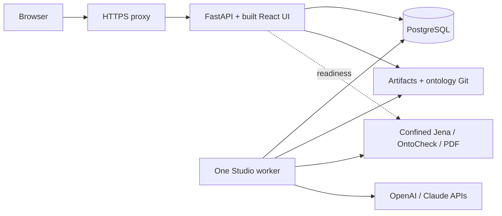

# Ubuntu test server implementation plan

> **For agentic workers:** Use `superpowers:subagent-driven-development` or `superpowers:executing-plans` to implement this plan task by task. Checkboxes describe future work, not completed deployment.

**Date:** 3 November 2026.
**Status:** Proposed plan with a read-only live host inspection completed. No installation, model call or deployment was performed.
**Goal:** Run the complete standalone Studio workflow on the user's Ryzen 7945HX test server, verified as Ubuntu 26.04.1 with 12.84 GiB kernel-visible RAM.
**Architecture:** One host runs an HTTPS proxy, FastAPI with the built React UI, one independent job worker and PostgreSQL. Jena, OntoCheck and PDF extraction run as confined child processes; model generation uses the existing server-owned OpenAI/Claude API profiles.
**Tech stack:** Ubuntu 26.04.1, systemd, Nginx, Python 3.12.14, uv/locked dependencies, Java 21, PostgreSQL 17.6 pinned image, Docker Compose for PostgreSQL, React production assets, and a proposed Linux Bubblewrap sandbox.
**Spec:** The [deployment design](#deployment-design) in this document, updated by the [live host inspection](evidence/ubuntu-host-inspection-2026-11-03.md). Test-only purpose is user supplied; the topology, resource budgets and rollout choices below are recommendations.

## Deployment design

**Recommendation: put all core Studio components on this server.** Live inspection confirmed 16 CPU cores / 32 threads, 12.84 GiB kernel-visible RAM, approximately 10.95 GiB available memory and 751 GiB free NVMe space under light current load. This supports the proposed synthetic test deployment, but is not an application benchmark or a promised user capacity. The initial user-reported Ubuntu 24.04 / 16 GB description is superseded for sizing by these observations; the reason for lower usable RAM was not investigated.

### Approaches considered

| Approach | What runs here | Tradeoff |
| --- | --- | --- |
| Core Studio first — recommended | Four persistent application services plus on-demand engines | Complete standalone workflow with the most RAM headroom; Linux confinement still needs implementation |
| Core plus full TrustGraph | Core plus seven additional containers, embeddings and optionally the portal host | Useful for integration tests, but tight on the measured 12.84 GiB and adds platform/identity/configuration work |
| Core here; TrustGraph on another machine later | Same core deployment with a separately verified remote integration | Preserves local RAM; requires another host and explicit integration/transport configuration |

Use the first approach for this test deployment. The other approaches remain options, not agreed purchases or additional work. Retain the installed Ubuntu 26.04.1 and verify against that release; this plan does not require an OS downgrade. Install project-specific pinned tools alongside existing tools. The observed system Python 3.14.4 cannot satisfy Studio's Python 3.12 requirement; the separate Python 3.12.13, Node 24.21.0 and uv 0.11.21 also differ from the repository pins. Java 25 meets the Java 21+ version floor but differs from the tested Java 21 runtime. [Exact live versions and required actions](evidence/ubuntu-host-inspection-2026-11-03.md).

### Component count

Count application services, not every OS daemon, thread or container subprocess:

| Component | Persistent service? | Placement |
| --- | --- | --- |
| Nginx HTTPS entry point | 1 | Proposed new service; forwards the same origin to Studio |
| FastAPI + compiled React UI | 1 | Existing app serves `apps/studio-plugin/dist`; no separate Vite server |
| Studio job worker | 1 | One process initially; proposal and test-generation agents are modules, not separate servers |
| PostgreSQL | 1 | Existing pinned Compose image; required for normal team mode |
| Jena validation | No | Confined Java process per invocation; no Fuseki server |
| OntoCheck assessment | No | Confined Python process using its separate environment |
| PDF extraction | No | Confined Python process per extraction |
| Artifacts and ontology Git history | No | Persistent directories; Git CLI, not a Git hosting service |
| OpenAI / Claude | External | Existing API integrations; no local generation model or GPU requirement |

**Total: four persistent application services, plus three on-demand engine types.** Readiness also invokes Jena/OntoCheck and can overlap worker activity. PostgreSQL supplies the durable job ledger; Redis, Celery and Kubernetes are unnecessary for this topology.

Evidence: [static UI mount](../services/api/src/oe_studio/main.py), [worker loop](../services/api/src/oe_studio/worker.py), [team settings](../services/api/src/oe_studio/settings.py), [database Compose](../infra/compose.yaml), and [architecture](architecture.md).

### Capacity budget

These are initial **planning allowances**, not measured consumption or already configured limits. Revisit them after testing:

| Use | Approximate RAM allowance |
| --- | ---: |
| Existing OS, Docker and light workloads | 2 GiB |
| New API, HTTPS proxy and readiness engine peaks | 1.5 GiB |
| One new worker including its engine children | 3 GiB |
| New isolated PostgreSQL | 1.5 GiB |
| Remaining nominal headroom within observed 12.84 GiB | About 4.8 GiB |

This revised budget allows approximately 6 GiB for new Studio services. The observed baseline is a momentary snapshot; existing workloads can grow. Re-measure before installation and keep the 3 GiB steady-load available-memory target below. Build during a quiet window. The observed 751 GiB free disk exceeds the initial 50 GiB operational allowance for dependencies, images, data and a restore copy; this is not a measured application minimum. Keep a protected backup on another machine/disk as well. Source/artifact retention determines long-term storage use.

Start with one worker and one Uvicorn process. More CPU cores do not justify automatically starting many memory-consuming workers. The code already bounds Jena to a 256 MiB heap, 128 MiB metaspace, two active processors and 30 seconds. PDF extraction has a 512 MiB RSS limit and 15-second wall deadline. OntoCheck defaults to a 20-second deadline (maximum 60 seconds) but lacks an equivalent process memory ceiling. Preserve these bounds and add tested Linux resource enforcement. [Jena](../services/api/src/oe_studio/validation.py), [PDF](../services/api/src/oe_studio/pdf_ingestion.py), [OntoCheck](../services/api/src/oe_studio/assessment.py).

### Why TrustGraph comes later

The checked-in base Compose has RabbitMQ, Cassandra, control and gateway. Its pipeline overlay adds Garage, Qdrant and pipeline: **seven additional containers**, or eleven persistent application services when combined with the proposed core. An embedding service and separately served portal can increase that count. The API-profile overlay replaces the pipeline service rather than adding another container. [Base Compose](../infra/portal/compose.yaml), [pipeline overlay](../infra/portal/pipeline.compose.yaml), [profile preparation](../infra/portal/prepare_llm.py).

Their declared container memory caps total 7.25 GiB, excluding core Studio, embeddings, portal, OS and build/cache overhead. A sum of caps is neither actual usage nor a proven capacity requirement. Current upstream guidance asks for 12 GB or more and eight CPUs available to TrustGraph itself. That makes simultaneous full-stack testing on this host with 12.84 GiB usable RAM a later measurement exercise, not the default. [TrustGraph quickstart](https://docs.trustgraph.ai/quickstart/).

Before adding it, verify amd64 image pins: the exercised TrustGraph digest is recorded as arm64. Resolve the historical `host.docker.internal:11434` embedding endpoint for Linux; current API completion does not replace embeddings. Rebuild the current API-profile worker instead of activating retired Qwen generation tooling. Verify portal routing/identity, provenance and all persistent stores separately. [Image metadata](../infra/portal/source-pins.json), [pipeline generator](../infra/portal/prepare_pipeline.py), [current integration](trustgraph-multi-llm.md), [remaining integration gates](integrations.md).

## Global constraints

- Scope is a trusted test deployment using synthetic data. No real study, confidential ingestion or organizational production claim follows from this plan.
- Preserve the current checkout's unrelated changes, private configuration, approved ontology history, immutable artifacts, audit records and historical evidence. Start with a fresh server test store rather than copying the user's live working store.
- Keep Python 3.12.14 and repository lockfiles, Java 21+, and OntoCheck in its isolated environment. Build for Linux/amd64; do not copy macOS virtual environments or native binaries.
- Models and retrieval never approve publication. Preserve exact immutable-bundle checks, human role decisions, A–D controls and successor requirements.
- A missing/broken sandbox must fail closed. No `isolation=off` workaround or unconfined fallback; Docker around the existing app alone does not implement Linux engine isolation.
- Configure team mode, PostgreSQL and an exact HTTPS origin for browser access by testers. Keep API/database ports private. Use existing operator-created accounts and project roles.
- No paid model calls are part of initial verification. Use deterministic demo or controlled endpoints explicitly configured for disposable tests; never switch a failed configured model to demo.

## Review focus

1. The actual Ubuntu 26.04.1 AppArmor/user-namespace restrictions: a denied launcher must produce an explicit failure (Task 2).
2. Host-filesystem, network, symlink/hard-link and descendant escapes: real Linux boundary tests must fail to access forbidden resources (Task 2).
3. HTTPS proxy/origin/session handling and cross-project access: test through the browser's actual entry point (Tasks 3–4).
4. Restart or interrupted model calls/publication: retain leases and uncertain-call failures without duplicated effects (Task 4).
5. Memory pressure and database/artifact/Git restore consistency: measure overlap and restore to a fresh target (Tasks 4–5).

## Task 1: Record the target and prepare a reproducible release

**Files:** Read `Makefile`, `.python-version`, `.node-version`, `.github/workflows/ci.yml`, lockfiles and `infra/compose.yaml`. Later create `docs/evidence/ubuntu-test-deployment-<actual-date>.md` for observed results.
**Consumes:** The user's host specification and current source checkout.
**Produces:** A sanitized host inventory and a release identity suitable for repeatable Linux installation.

- [x] Record the host architecture/OS, CPU, memory, disk, existing workloads and listening ports. See the dated live inspection; recheck volatile resource/port values immediately before installation.
- [ ] Select the test hostname/access route and certificate method: a trusted internal certificate for LAN access or a valid certificate for the chosen DNS name. Preserve existing server services and port assignments.
- [ ] Record the exact reviewed source commit plus any intentionally included patch. Resolve release inclusion of existing uncommitted work with its owner; never silently omit it, reset it or copy the whole private workspace.
- [ ] Build a Linux release in the repository layout using Python 3.12.14, Node 26.13.0, uv 0.13.6, the recorded Maven 3.10.0 build tool and tested Java 21.0.13 runtime, plus lockfiles. Install these alongside existing tools, with explicit Linux `JAVA_HOME`/`OE_JAVA_EXECUTABLE`, then run `make setup` and `make build`. Include built UI, runner JAR and required resources. Do not run application services with `--reload` or the Vite dev server.

**Acceptance:** Reproducible Linux build and documented host baseline. Successful build alone does not satisfy engine readiness.

## Task 2: Implement and prove Linux engine confinement — blocking dependency

**Files:** Modify `services/api/src/oe_studio/engine_isolation.py`, `tests/test_engine_isolation.py` and `.github/workflows/ci.yml`; add `tests/probes/linux_network.py`. Adjust the three engine wrappers only where Linux launch/resource handling requires it. Add a scoped AppArmor deployment profile under `infra/ubuntu/` if host verification requires one.
**Consumes:** Existing `isolated_command(command: list[str], *, workdir: Path, readable: list[Path]) -> tuple[list[str], dict]` and `isolation_configuration() -> dict` contracts.
**Produces:** The same interfaces with verified Linux support and distinct, stable policy/runtime metadata included in the engine fingerprint.

Current code explicitly accepts only macOS Seatbelt on Darwin; Linux returns unsupported. This blocks Jena, OntoCheck and PDF extraction, and makes engine readiness fail. [Launcher](../services/api/src/oe_studio/engine_isolation.py), [readiness](../services/api/src/oe_studio/health.py), [current Mac CI](../.github/workflows/ci.yml).

- [ ] Add failing Linux cases for the existing interface: declared inputs readable, scratch writable, runtime read-only, secrets/approved store unreadable, escape links denied, native TCP/UDP and descendants confined, and missing/denied launcher never retried unconfined. Linux namespace denial may have a different errno from macOS; assert denied access and unchanged canaries, not only Mac-specific errno values.
- [ ] Implement a `linux-bubblewrap` backend with a minimal filesystem, declared read-only runtime/input mounts, one writable scratch area and no network. Keep the Mac path. Fingerprint the effective policy and relevant runtime identity; preserve sanitized environments and report metadata.
- [ ] Verify the application policy with Bubblewrap under the actual Ubuntu 26.04.1 AppArmor configuration. A minimal namespace launch already succeeded with Bubblewrap 0.11.1 and restrictions enabled, but the probe exposed the host filesystem read-only and does not prove application confinement. Add narrowly scoped permissions only if policy tests require them; do not globally disable AppArmor/user-namespace restrictions. [Bubblewrap documentation](https://github.com/containers/bubblewrap), [live capability probe](evidence/ubuntu-host-inspection-2026-11-03.md).
- [ ] Enforce tested memory/process/time/output limits for engines and kill/reap the complete child process tree on timeout or cancellation. Exercise memory exhaustion and descendant cleanup. Choose conservative per-engine limits using the bounded fixtures; do not confuse Java heap size with total process memory.
- [ ] Run real Ubuntu isolation, validation, assessment, PDF and benchmark suites. Extend CI to Ubuntu while retaining Mac coverage. Configuration changes must invalidate outstanding check eligibility without rewriting approved history.

**Verification:** `.venv/bin/python -m pytest tests/test_engine_isolation.py tests/test_validation.py tests/test_assessment.py tests/test_pdf_ingestion.py tests/test_benchmark_compatibility.py -q`, followed by affected workflow tests. A skip or sandbox failure is not acceptance.

## Task 3: Install the four-service test topology

**Files:** Create `infra/ubuntu/ontology-api.service`, `infra/ubuntu/ontology-worker.service`, `infra/ubuntu/nginx.conf` and a secret-free `infra/ubuntu/studio.env.example`. Add an Ubuntu section to `docs/operations.md`. Retain `infra/compose.yaml`'s pinned PostgreSQL image.
**Consumes:** Task 2's verified Linux release and Task 1's hostname/certificate choice.
**Produces:** One HTTPS origin serving the built application, one worker and persistent PostgreSQL/storage.

- [ ] Install the release under `/opt/ontology-studio/`, private configuration under `/etc/ontology-studio/`, and fresh test data under `/var/lib/ontology-studio/`. Run application processes as a dedicated non-root account. Keep private secrets outside release artifacts and engine mounts.
- [ ] Start the separately pinned PostgreSQL 17.6 container with its named volume, localhost port 54329, private generated password and restart-on-boot policy. Preserve existing native PostgreSQL 18 on port 5432, the stopped PostgreSQL 16 cluster and existing Docker data. Record the new volume location. Migrate only Studio's new database before starting API/worker; service restart must not perform uncontrolled schema changes.
- [ ] Set `OE_MODE=team`, `OE_DATABASE_URL`, `OE_DATA_DIR`, `OE_TEAM_ORIGIN=https://<chosen-host>`, `OE_EMBEDDED_WORKER=false`, Linux Java/OntoCheck paths and `OE_ENGINE_ISOLATION=linux-bubblewrap` once Task 2 implements it. Supply identical relevant private configuration to API and worker. Keep insecure-loopback/test-SQLite flags off.
- [ ] Configure systemd to start Uvicorn on `127.0.0.1:8000` and `python -m oe_studio.worker` separately with the repository working directory and `PYTHONPATH=services/api/src`. Apply compatible resource/service restrictions; allow bounded jobs to finish on shutdown and preserve crash recovery. Validate restart-on-boot behavior.
- [ ] Configure Nginx for the single HTTPS origin, preserving `/api/v1` paths, Host and Origin. Trust forwarded headers only from the loopback proxy. Accommodate the existing 20 MiB upload limit plus multipart overhead. Test the certificate, secure cookies, CSRF and proxy request/timeout limits.
- [ ] Provision synthetic test accounts/project roles using `account_cli`. Configure project-authorized model profiles on the server only when required; catalog/readiness checks must not generate billable requests.

**Acceptance:** `systemd-analyze verify` for units and `nginx -t` pass; liveness/readiness succeed; the UI loads via HTTPS; the worker drains a controlled synthetic job; reboot restores services. Validate through the real proxy, not only direct loopback requests.

## Task 4: Verify the full synthetic workflow and recovery

**Files:** Existing `tests/integration/test_team_access.py`, `test_worker_process.py`, `test_real_engine_workflow.py`, `test_workflow.py` and contract suites; add focused deployment regressions only where new behavior lacks coverage. Record actual evidence in Task 1's report.
**Consumes:** The running disposable team environment.
**Produces:** Evidence of Ubuntu workflow correctness, recovery and coordinated restore.

- [ ] Run relevant unit/contract/integration suites plus frontend tests/build, `make lint`, `make check-api-contracts` and `git diff --check`. Retain actual passes, failures and skips.
- [ ] Perform browser checks for login, project denial, CSRF, text/PDF sources, proposal/test generation, real Jena/OntoCheck results and exact-bundle review. Use controlled model responses. A manual review requires a real tester decision; automated approvals/publication fixtures stay in separately labelled disposable test stores.
- [ ] Verify no paid provider traffic during controlled tests. Model failures remain explicit. Record any later live-provider probe separately with its own authorization/bounds; readiness is not such a probe.
- [ ] Exercise graceful worker stop, abrupt interruption and publication recovery. Demonstrate no automatic replay of an uncertain external call and no duplicate publication effect.
- [ ] Stop writers; back up PostgreSQL with version-compatible `pg_dump`, plus artifacts and ontology Git from that same maintenance window. Protect configuration separately. Restore to a fresh database/directory, compare rows/artifact hashes/Git refs and run `git fsck`. The SQLite backup utility is not a PostgreSQL backup path.

**Acceptance:** Complete synthetic workflow, explicit negative cases and exact restore evidence; no changes to the user's working ontology. [Existing operations/recovery contract](operations.md).

## Task 5: Measure capacity, then decide whether to expand

**Files:** Add a small controlled workload driver under `scripts/` only if existing test tooling cannot supply the sessions; record measurements in the deployment evidence report.
**Consumes:** Task 4's verified core deployment and separate synthetic test identities.
**Produces:** Measured capacity for this workload, not a generic maximum-user claim.

- [ ] Test 1, 3, 5 and 10 concurrent sessions progressively, for at least 10 minutes per level. Mix browsing with bounded queued jobs; use controlled provider responses with stated simulated latency and real local engines. Stop escalation when the criteria below fail.
- [ ] Record API/worker/database/child-process memory, host available RAM, CPU, swap pressure, disk growth, API latency, queue waiting time, job runtime and failures. Include overlap with readiness probes. A model's external latency/rate limit is separate from server capacity.
- [ ] Use provisional acceptance targets: no OOM/restarts/unexpected job failures; at least 3 GiB `MemAvailable` during steady load; ordinary read API p95 below one second excluding model/engine work; queue clears within five minutes after submissions stop. These are test targets, not observed results or user-agreed service levels.
- [ ] Increase to two workers only after the single-worker result demonstrates a queue bottleneck and adequate memory, then rerun the same workload and recovery checks. Do not size workers from CPU core count alone.
- [ ] Keep the measured working configuration. Consider TrustGraph on demand, another host, or a RAM upgrade only if those integration tests are needed and measurements justify it. No hardware upgrade is presently required by this core-only plan.

## Handoff and remaining inputs

The implementation order is **Linux confinement → core services → synthetic workflow/restore → measured load → optional TrustGraph**. Task 1 can gather inventory/build inputs while confinement work is prepared.

The live inventory is recorded. Before actual installation, recheck resource/port availability and select the test hostname/certificate route and approved installation access. Ports 443, 8000 and 54329 had no TCP listeners during inspection; another app already uses port 8080. The next engineering deliverable is verified Ubuntu confinement, not a full TrustGraph deployment.

This investigation inspected current code/configuration, dated evidence and the actual server through Remote Desktop Commander. The current checkout has unrelated uncommitted changes which remain intact. Only host inventory and a minimal launcher capability probe were executed on Ubuntu; Studio runtime and concurrent-user capacity remain untested. Historical Mac test counts are not Linux evidence.

Initial planning verification: 85 local Markdown link/path targets across the then-current plan, documentation index and implementation ledger resolved. Direct YAML inspection confirmed seven TrustGraph services and 7.25 GiB of declared caps. An independent read-only deployment review found no consequential issues. The live follow-up records its separate scope in the dated inspection report; no application tests or deployments are implied.
